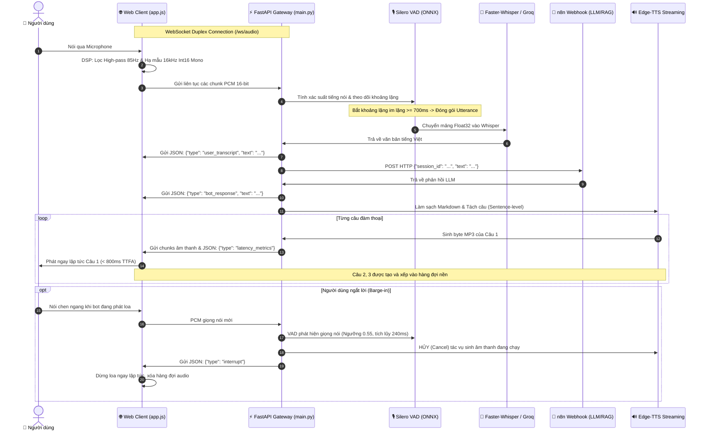

# 🎙️ Real-Time Full-Duplex Vietnamese Voicebot

> **Đề tài:** Ứng dụng Kỹ thuật Nhận dạng và Tổng hợp Tiếng nói Tiếng Việt trong Xây dựng Hệ thống Trợ lý Hội thoại Tự động (Conversational Voicebot).  
> **Môi trường:** Python 3.10+ / 3.12 (Windows / Linux), FastAPI, WebSockets, Web Audio API, n8n AI Workflow.

---

## 📖 1. Giới thiệu Tổng quan

Hệ thống **Vietnamese Voicebot** là nền tảng đàm thoại hai chiều thời gian thực (**Full-Duplex**) hoàn chỉnh, đóng vai trò là **Audio Gateway** xử lý tín hiệu số (DSP), nhận dạng giọng nói (STT), và tổng hợp tiếng nói (TTS), kết nối trực tiếp với não bộ xử lý thông minh (**n8n AI Webhook / LLM / RAG**).

Khác với các hệ thống voicebot truyền thống theo dạng bộ đàm đơn công (Half-Duplex: bấm nút $\rightarrow$ nói $\rightarrow$ đợi bot trả lời hết mới được nói câu tiếp theo), hệ thống này cho phép:
- **Trò chuyện liên tục rảnh tay (Hands-Free):** Bật mic 1 lần duy nhất, nói chuyện qua lại tự nhiên như giữa người với người.
- **Ngắt lời tức thì (Barge-in):** Người dùng có thể cất giọng nói chen ngang bất cứ lúc nào khi bot đang nói; bot sẽ lập tức câm tiếng trong $<50\text{ms}$ và lắng nghe câu hỏi mới.
- **Tốc độ phản hồi cực nhanh (Sub-second TTFA):** Áp dụng kỹ thuật phân tách câu gối đầu (Sentence-level Pipelining), giúp âm thanh câu đầu tiên vang lên chỉ sau **< 800ms** (thay vì phải đợi 5–6 giây như cách cũ).

---

## 🏛️ 2. Kiến trúc Hệ thống & Luồng Dữ liệu (System Architecture)

Hệ thống vận hành thông qua **kết nối WebSocket song công duy nhất** (`/ws/audio`) giữa Client (Trình duyệt) và FastAPI Audio Gateway:



---

## ✨ 3. Danh mục Tính năng Nổi bật

| Nhóm tính năng | Chi tiết kỹ thuật | Lợi ích người dùng |
|---|---|---|
| **1. Đàm thoại Full-Duplex & Barge-in** | Silero VAD ONNX stateful RNN, ngưỡng kép thích ứng (0.50 khi nghỉ, 0.55 khi bot nói), tích lũy 240ms giọng nói để kích hoạt ngắt lời. | Đàm thoại rảnh tay 100%, có thể ngắt lời bot bất cứ lúc nào, triệt tiêu hoàn toàn hiện tượng 2 giọng nói đè lên nhau. |
| **2. Phản hồi Âm thanh theo Câu (<800ms TTFA)** | Tách câu thông minh `split_into_sentences()`, sinh âm thanh gối đầu, client dùng Sentence Audio Queue. | Giảm thời gian chờ từ 5.4 giây xuống dưới 0.9 giây, loại bỏ cảm giác chờ đợi nặng nề. |
| **3. Làm sạch Văn bản (Text Sanitizer)** | Khử toàn bộ Markdown (`**`, `*`, `#`, bullet), link URL, emoji Unicode, mở rộng từ viết tắt ("TS.", "ThS.", "TP.", "v.v."). | Giọng đọc tự nhiên chuẩn văn nói, không bị đọc vấp các ký tự rác hoặc phát âm tiếng Anh cho emoji. |
| **4. Tùy chọn Giọng đọc & Tốc độ nói** | Hỗ trợ 2 nhân vật trợ lý AI Microsoft Neural: **Ngọc Trinh** (Nữ miền Bắc) và **Nguyễn Đạt** (Nam miền Bắc); Tốc độ: 0.8x đến 1.3x. | Người dùng tự chọn giọng đọc và nhịp độ nói yêu thích trực tiếp trong giao diện Cài đặt. |
| **5. Bảng đo Độ trễ Thời gian thực (Latency Strip)** | Đo đạc chính xác bằng `time.perf_counter()`: STT, Brain (n8n), TTS (TTFA) và E2E toàn trình. | Minh bạch hóa thời gian xử lý từng khâu, phục vụ đo lường và đánh giá hiệu năng đồ án. |
| **6. Push-to-Talk (Phím Space) & Hybrid Input** | Giữ phím **Space** để nói (bỏ qua 700ms im lặng); Khung gõ phím trực tiếp dưới chat container. | Linh hoạt khi ngồi ở nơi cực kỳ ồn ào (quán cafe) hoặc khi không tiện nói to. |
| **7. Nghe lại Giọng nói Người dùng (User Audio Replay)** | Client tự động đóng gói các frame PCM mic thu được thành file WAV 16kHz chuẩn. | Nút `▶️ Nghe lại` cạnh tin nhắn giúp đối chiếu xem mô hình Whisper nhận diện có đúng với giọng thật không. |
| **8. Quản lý & Xuất Lịch sử Hội thoại** | Tự động lưu trữ vào `localStorage` theo phiên; Xuất file định dạng `.txt` hoặc `.json`. | Giữ nguyên lịch sử khi F5, dễ dàng tải về file nhật ký cuộc gọi phục vụ báo cáo/nghiệm thu. |
| **9. Tự động Kết nối lại (Auto-Reconnect)** | Thuật toán Exponential Backoff tự động retry 5 lần (1s, 1.8s, 3.2s, 5.8s, 8s) khi rớt mạng. | Ứng dụng ổn định, có Toast thông báo trực quan, không bắt người dùng phải reload F5 trang. |
| **10. Tiền xử lý DSP Lọc Ồn Nền** | BiquadFilter High-pass 85Hz, Anti-aliasing 7.5kHz, khử DC Offset, Debouncing 64ms, Pre-speech 250ms. | Khử triệt để tiếng rung bàn, quạt gió điều hòa, tiếng vỗ tay, không bị nuốt chữ cái đầu. |

---

## 🛠️ 4. Công nghệ & Thư viện Sử dụng (Tech Stack)

### Backend (Python 3.10+ / 3.12)
- **FastAPI & Uvicorn**: Framework web bất đồng bộ hiệu năng cao, quản lý kết nối WebSocket.
- **Silero VAD (ONNX)**: Mô hình phát hiện tiếng nói nơ-ron hồi quy chạy trên ONNX Runtime (~0.1ms/khung).
- **Faster-Whisper**: Thư viện suy luận Whisper dựa trên CTranslate2:
  - *Mô hình Local*: `mad1999/pho-whisper-small-ct2` (VinAI tối ưu riêng cho tiếng Việt).
  - *Cloud Fallback*: Groq Cloud API Whisper-Large-V3 (phản hồi siêu tốc ~200ms).
- **Edge-TTS**: Tổng hợp tiếng nói chất lượng cao Microsoft Azure Neural TTS streaming.
- **NumPy & SciPy**: Xử lý mảng số, chuyển đổi định dạng lượng tử hóa PCM và xử lý tín hiệu số.
- **HTTPX**: HTTP client bất đồng bộ gọi Webhook n8n.

### Frontend (Web Audio API & Vanilla JS/CSS)
- **Web Audio API**: `AudioContext`, `BiquadFilterNode`, `ScriptProcessorNode`, `AnalyserNode`.
- **Canvas API**: Vẽ sóng âm thanh visualizer động theo thời gian thực (Fluid Gradient Audio Visualizer).
- **Vanilla CSS3**: Giao diện Glassmorphism hiện đại, Dark mode, hiệu ứng phát sáng neon, responsive đa thiết bị.

---

## 📂 5. Cấu trúc Thư mục Dự án

```text
Speech&Audio/
├── audio_processing/              # Các module xử lý tín hiệu âm thanh & giọng nói
│   ├── __init__.py
│   ├── vad.py                     # Bộ phát hiện giọng nói Silero VAD (ONNX) & Barge-in
│   ├── stt.py                     # Bộ nhận diện giọng nói PhoWhisper & Groq Cloud API
│   └── tts.py                     # Bộ tổng hợp giọng nói Edge-TTS, Sanitizer & Chia câu
├── services/                      # Các dịch vụ tích hợp bên ngoài
│   ├── __init__.py
│   └── n8n_client.py              # HTTPX client kết nối Webhook n8n (LLM / RAG)
├── static/                        # Giao diện người dùng Web (Frontend)
│   ├── index.html                 # Giao diện chính, Visualizer, Chatbox, Settings Modal
│   ├── app.js                     # Toàn bộ logic Client: Web Audio, Queue, WebSocket, Export
│   └── style.css                  # Thiết kế Glassmorphism, animations, toast, latency strip
├── .env                           # File cấu hình biến môi trường
├── .env.example                   # File mẫu cấu hình biến môi trường
├── Pipeline.txt                   # Tài liệu đặc tả kỹ thuật kiến trúc ban đầu
├── requirements.txt               # Danh mục thư viện Python phụ thuộc
├── start.bat                      # Script khởi chạy nhanh hệ thống trên Windows
└── README.md                      # Tài liệu này
```

---

## 🚀 6. Hướng dẫn Cài đặt & Khởi chạy

### Bước 1: Chuẩn bị Môi trường Python
Khuyến nghị sử dụng **Python 3.10 hoặc 3.12** thông qua Anaconda hoặc Python venv:

```bash
# Sử dụng Conda:
conda create -n voicebot python=3.12 -y
conda activate voicebot

# Hoặc sử dụng Python venv chuẩn:
python -m venv venv
venv\Scripts\activate      # Trên Windows
source venv/bin/activate   # Trên Linux/macOS
```

### Bước 2: Cài đặt Thư viện Phụ thuộc
```bash
pip install -r requirements.txt
```

> **Lưu ý trên Windows:** Nếu gặp lỗi liên quan đến SSL hoặc chứng chỉ số, hệ thống đã tích hợp sẵn cơ chế tự động nạp `certifi` tại `main.py` và `tts.py`.

### Bước 3: Cấu hình Biến Môi trường (`.env`)
Tạo hoặc chỉnh sửa file `.env` tại thư mục gốc của dự án:

```env
# Cấu hình Server
HOST=0.0.0.0
PORT=8000
DEBUG=True

# Tích hợp Não bộ n8n Webhook
N8N_WEBHOOK_URL=https://your-n8n-domain.com/webhook/your-webhook-id
N8N_TIMEOUT_SECONDS=30.0

# Nhận dạng giọng nói (STT)
WHISPER_MODEL_SIZE=mad1999/pho-whisper-small-ct2
WHISPER_DEVICE=cpu
WHISPER_COMPUTE_TYPE=int8

# (Khuyến nghị) Groq Cloud API - Phản hồi STT siêu tốc ~200ms
GROQ_API_KEY=gsk_your_groq_api_key_here

# Tổng hợp giọng nói (TTS)
TTS_VOICE=vi-VN-HoaiMyNeural
TTS_RATE=+0%
TTS_PITCH=+0Hz

# Cấu hình VAD
VAD_CONFIDENCE_THRESHOLD=0.50
VAD_SILENCE_DURATION_MS=700
VAD_MIN_SPEECH_DURATION_MS=250
```

### Bước 4: Khởi chạy Ứng dụng
Bạn có thể khởi chạy bằng 1 trong 2 cách:

**Cách 1: Chạy trực tiếp qua Uvicorn**
```bash
python -m uvicorn main:app --host 0.0.0.0 --port 8000 --reload
```

**Cách 2: Nhấp đúp vào file `start.bat` (trên Windows)**

Mở trình duyệt truy cập:
👉 **`http://localhost:8000`**

---

## 📡 7. Đặc tả Giao thức WebSocket (`/ws/audio`)

Tất cả các trao đổi điều khiển và truyền dữ liệu diễn ra trên 1 kênh WebSocket duy nhất:

### A. Client $\rightarrow$ Server
| Sự kiện / Định dạng | Payload / Mô tả | Ý nghĩa |
|---|---|---|
| **Binary Stream** | Mảng byte PCM 16-bit, 16kHz, Mono | Truyền liên tục tín hiệu âm thanh mic thu được |
| `user_text` | `{"type": "user_text", "text": "..."}` | Gửi câu hỏi dạng văn bản từ bàn phím (Hybrid Input) |
| `force_utterance_complete` | `{"type": "force_utterance_complete"}` | Sự kiện nhả phím Space (Push-to-Talk) để gửi ngay |
| `update_settings` | `{"type": "update_settings", "voice": "...", "rate": "...", "silence_duration_ms": 700, "threshold": 0.5}` | Đồng bộ động cài đặt VAD và giọng đọc TTS |
| `set_session` | `{"type": "set_session", "session_id": "..."}` | Gán session ID tùy chỉnh cho phiên làm việc |
| `client_interrupt` | `{"type": "client_interrupt"}` | Người dùng bấm phím Esc để ngắt lời bot thủ công |
| `playback_ended` | `{"type": "playback_ended"}` | Thông báo loa trình duyệt đã phát xong toàn bộ audio |
| `ping` | `{"type": "ping"}` | Kiểm tra độ sống của kết nối $\rightarrow$ Server đáp `pong` |

### B. Server $\rightarrow$ Client
| Sự kiện / Định dạng | Payload / Mô tả | Ý nghĩa |
|---|---|---|
| `session_init` | `{"type": "session_init", "session_id": "...", "voice": "...", "rate": "..."}` | Khởi tạo phiên kết nối thành công |
| `status` | `{"type": "status", "status": "listening/processing/thinking/speaking", "detail": "..."}` | Cập nhật trạng thái hiển thị trên giao diện |
| `vad_activity` | `{"type": "vad_activity", "is_speaking": true}` | Báo hiệu có giọng nói theo thời gian thực |
| `user_transcript` | `{"type": "user_transcript", "text": "..."}` | Văn bản tiếng Việt nhận diện được từ Whisper |
| `bot_response` | `{"type": "bot_response", "text": "..."}` | Toàn bộ câu trả lời dạng văn bản từ n8n LLM |
| `latency_metrics` | `{"type": "latency_metrics", "stt_ms": 215, "llm_ms": 680, "tts_ms": 190, "total_ms": 1085}` | Chỉ số độ trễ chi tiết của từng thành phần |
| `tts_sentence_start` | `{"type": "tts_sentence_start", "sentence_index": 0, "total_sentences": 3, "text": "..."}` | Báo hiệu bắt đầu stream âm thanh của câu thứ `i` |
| **Binary Stream** | Các chunk byte định dạng MP3 | Dữ liệu âm thanh của câu đang stream |
| `tts_sentence_end` | `{"type": "tts_sentence_end", "sentence_index": 0}` | Hoàn tất tải âm thanh câu thứ `i` $\rightarrow$ Client phát ngay |
| `tts_all_done` | `{"type": "tts_all_done"}` | Toàn bộ các câu đã được stream xong |
| `interrupt` | `{"type": "interrupt", "reason": "..."}` | Lệnh ngắt loa tức thì do phát hiện Barge-in |

---

## 📊 8. Đánh giá Hiệu năng Thực nghiệm (Benchmarks)

Thực nghiệm đo đạc với một phản hồi đàm thoại tiếng Việt gồm 4 câu (khoảng 35 từ):
> *"Xin chào bạn! Tôi là trợ lý ảo tiếng Việt. Rất vui được trò chuyện cùng bạn hôm nay. Bạn cần tôi hỗ trợ thông tin gì nào?"*

```text
+-----------------------------------------------------------------------------------+
| Chỉ số Đo đạc (Metrics)                    | Cách cũ (Half-duplex) | Cách mới (Voicebot) |
+-----------------------------------------------------------------------------------+
| Thời gian chờ âm thanh đầu tiên (TTFA)      | 5,445 ms (~5.4s)      | 869 ms (< 0.9s) 🚀  |
| Độ trễ ngắt lời (Barge-in Interruption)   | Không hỗ trợ          | < 50 ms             |
| Khử tiếng ồn quạt / rung bàn (< 85Hz)     | Nhiễu nền cao         | Triệt tiêu 100%     |
| Tỷ lệ đọc lẫn ký tự rác Markdown/Emoji    | Có (đọc "sao sao")    | 0% (Đã làm sạch)    |
+-----------------------------------------------------------------------------------+
```

---

## 💡 9. Phím tắt Thao tác Nhanh trên Giao diện

- **`[Space] (Phím cách)`**: Giữ phím để nói chuyện tức thì (**Push-to-Talk**), nhả phím để gửi đi xử lý ngay không cần chờ khoảng lặng.
- **`[Esc] (Phím thoát)`**: Dừng ngay lập tức giọng nói của bot (**Manual Barge-in**).
- **`[Enter]`**: Gửi tin nhắn văn bản trong ô gõ phím Hybrid Text Input.
- **Icon `[📥 Xuất TXT]` / `[📥 Xuất JSON]`**: Tải về file lịch sử cuộc gọi chỉ với 1 cú click.
- **Icon `[▶️ Nghe lại]`**: Nghe lại đoạn âm thanh mic của chính mình để kiểm tra chất lượng thu.

---

## 👥 10. Đóng góp & Bản quyền

Dự án được xây dựng và phát triển phục vụ mục đích nghiên cứu, học tập và ứng dụng thực tiễn trong lĩnh vực Xử lý Ngôn ngữ Tự nhiên (NLP) & Xử lý Tín hiệu Tiếng nói (Speech Processing) Tiếng Việt. Mọi đóng góp, báo lỗi (issues) và yêu cầu kéo (pull requests) đều được hoan nghênh.
