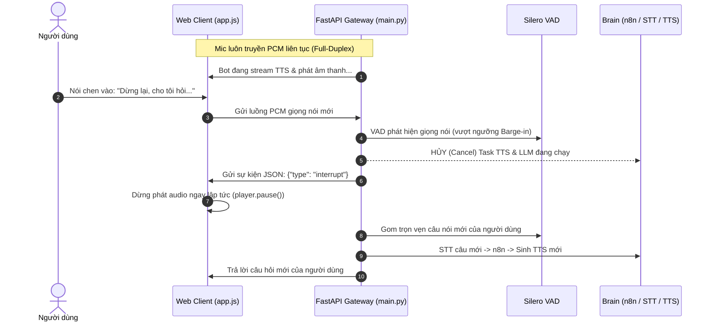

# Kế Hoạch Triển Khai Bước 2: Full-Duplex & Cơ Chế Ngắt Lời (Barge-In)

## Mục tiêu Bước 2
Nâng cấp hệ thống Voicebot từ dạng "hỏi - đáp tuần tự" (Half-Duplex) lên **Trò chuyện 2 chiều thời gian thực liên tục (Full-Duplex)** với cơ chế **Ngắt lời (Barge-in / Interruption)** tự nhiên:
1. **Trò chuyện rảnh tay liên tục (Hands-Free Loop):** Người dùng chỉ cần bật mic 1 lần duy nhất lúc đầu; sau đó có thể nói chuyện qua lại với bot liên tục mà không cần ấn lại nút mic.
2. **Ngắt lời tức thì (Barge-in):** Khi bot đang trả lời (hoặc đang phát âm thanh), nếu người dùng cất giọng nói chen vào, hệ thống sẽ:
   - Ngắt ngay lập tức âm thanh đang phát ở trình duyệt.
   - Hủy ngay lập tức tác vụ sinh âm thanh TTS trên server.
   - Chuyển sang thu thập câu nói mới của người dùng và xử lý ngay lập tức.

---

## Kiến trúc Kỹ thuật (Full-Duplex Architecture)

---

## Các thay đổi chi tiết (Proposed Changes)

### 1. Server Core: Xử lý Bất đồng bộ Concurrency & Task Cancellation
#### [MODIFY] [main.py](file:///c:/Speech&Audio/main.py)
- **Tách kiến trúc thành 2 luồng độc lập trong WebSocket:**
  - `receive_task`: Luôn chạy `websocket.receive()` liên tục, không bao giờ bị block bởi STT, n8n hay TTS.
  - `pipeline_task`: Tác vụ async xử lý chuỗi STT $\rightarrow$ n8n $\rightarrow$ TTS streaming.
- **Cơ chế Barge-in Cancellation:**
  - Khi bot đang ở trạng thái `speaking` hoặc `processing`, nếu VAD phát hiện người dùng nói liên tục $\ge 300\text{ms}$ (Barge-in):
    - Gọi `pipeline_task.cancel()` để dừng ngay TTS/LLM.
    - Gửi thông điệp `{"type": "interrupt"}` tới client để dừng ngay loa.
    - Reset buffer phát của bot và chuyển sang thu nhận câu nói mới.

### 2. Audio Processing: Tối ưu VAD khi Bot đang nói
#### [MODIFY] [audio_processing/vad.py](file:///c:/Speech&Audio/audio_processing/vad.py)
- Bổ sung chế độ `set_bargein_mode(is_bot_speaking: bool)`:
  - Khi bot đang nói, nâng nhẹ ngưỡng nhạy VAD (threshold từ 0.5 lên 0.65 và min speech duration từ 250ms lên 300ms) để lọc triệt để tiếng vọng từ loa ngoài (Acoustic Echo), đảm bảo chỉ ngắt lời khi người dùng thực sự cất giọng rõ ràng.
  - Khi bot im lặng, đưa về ngưỡng nhạy cao tiêu chuẩn để bắt giọng thì thầm/tự nhiên.

### 3. Web Client: Web Audio API & Xử lý Ngắt phát
#### [MODIFY] [static/app.js](file:///c:/Speech&Audio/static/app.js)
- **Không chặn Mic khi bot đang nói:** Xóa điều kiện chặn mic `if (this.isBotSpeaking) return;` trong `onaudioprocess`. Mic vẫn gửi PCM liên tục kèm bộ lọc chống dội (Echo Cancellation).
- **Xử lý sự kiện `interrupt`:**
  - Ngắt ngay `currentAudioPlayer.pause()`, giải phóng Blob URL, làm rỗng mảng `ttsChunks`.
  - Cập nhật UI trạng thái: Badge nhấp nháy *"⚡ Đã ngắt lời bot - Đang nghe bạn..."*.
- **Vòng lặp rảnh tay (Hands-Free):** Sau khi phát xong (hoặc bị ngắt), tự động giữ trạng thái lắng nghe sẵn sàng cho câu tiếp theo.

### 4. Giao diện & Hiệu ứng UI
#### [MODIFY] [static/style.css](file:///c:/Speech&Audio/static/style.css)
- Thêm animation visualizer phản hồi khi có sự kiện ngắt lời (Barge-in flash effect).

---

## Kế hoạch Kiểm thử & Xác thực (Verification Plan)

### 1. Kiểm thử Trò chuyện Liên tục (Hands-Free Continuous Mode)
- Mở `http://127.0.0.1:8000/`, bấm mic 1 lần.
- Nói câu 1: *"Xin chào"*.
- Đợi bot trả lời xong $\rightarrow$ Nói tiếp câu 2: *"Hôm nay là thứ mấy?"* mà **không chạm vào chuột hay bàn phím**.
- Kiểm tra bot có tự động nhận diện và phản hồi tiếp tục không.

### 2. Kiểm thử Cơ chế Ngắt lời (Barge-In)
- Nói một câu khiến bot trả lời dài.
- Trong lúc bot đang phát giọng đọc dở dang, cất giọng nói chen ngang: *"Dừng lại, nghe tôi nói này"*.
- **Kết quả mong đợi:**
  - Âm thanh bot lập tức câm tiếng trong vòng $<100\text{ms}$.
  - Server hiển thị log `Barge-in triggered! Cancelling ongoing TTS pipeline...`.
  - Bot nhận diện câu nói mới của bạn và trả lời câu mới.
