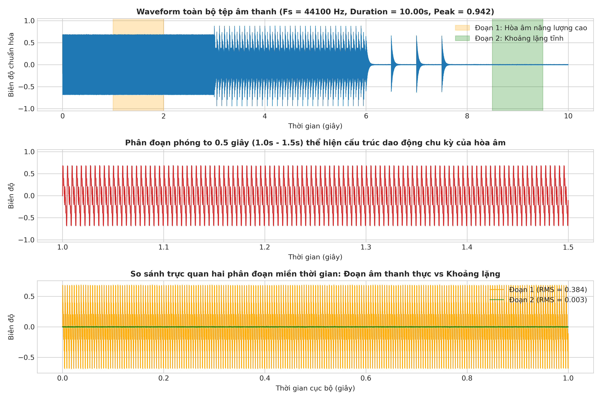
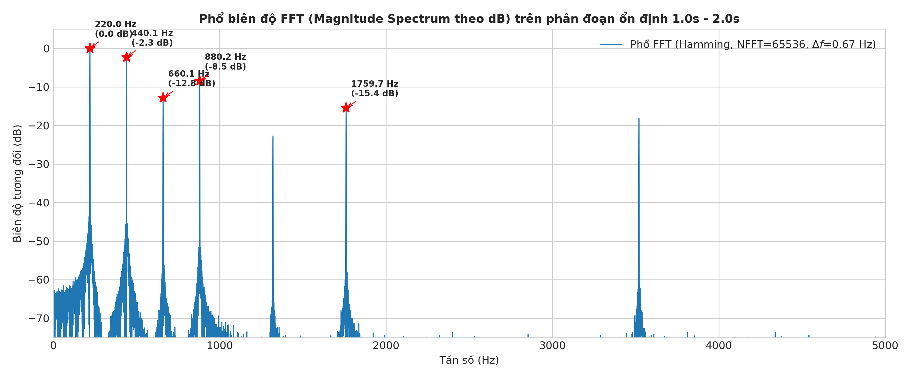
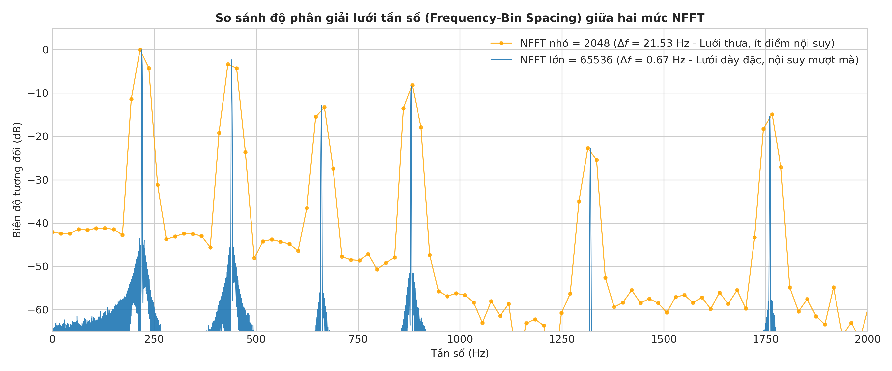
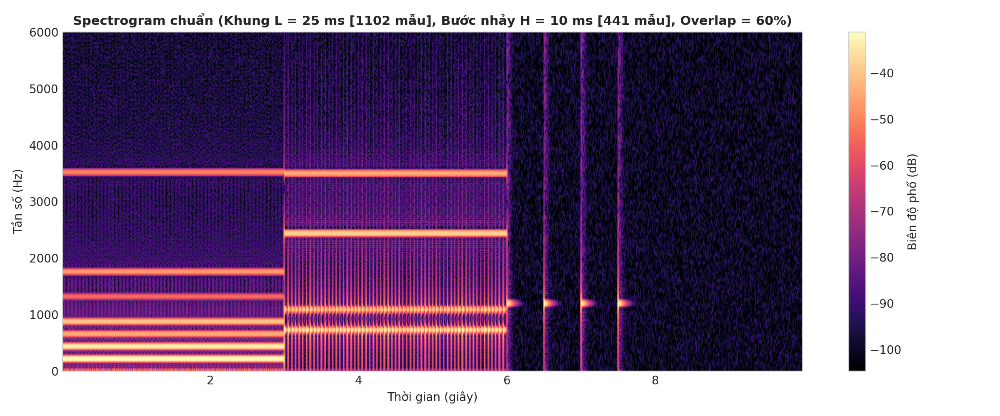
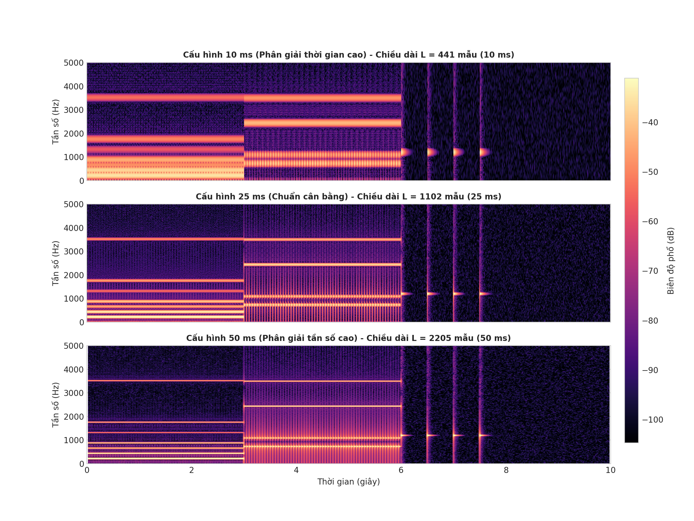
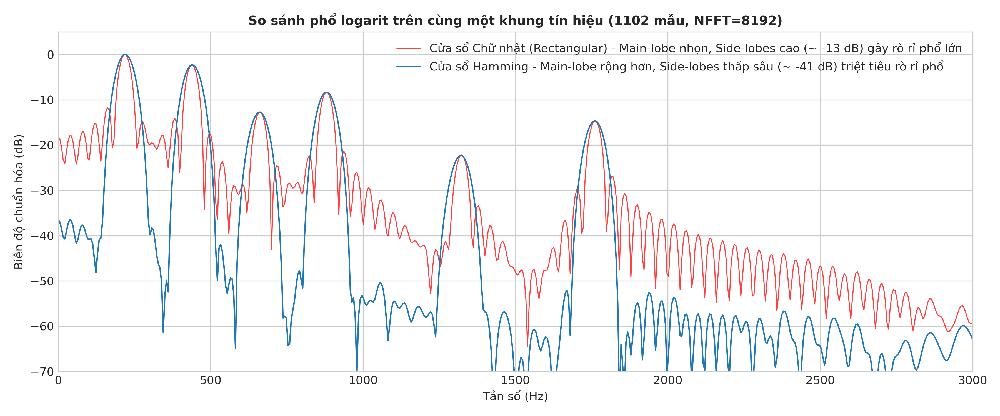
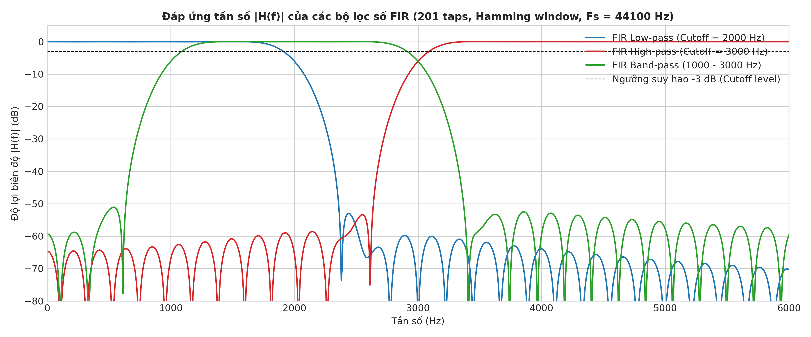
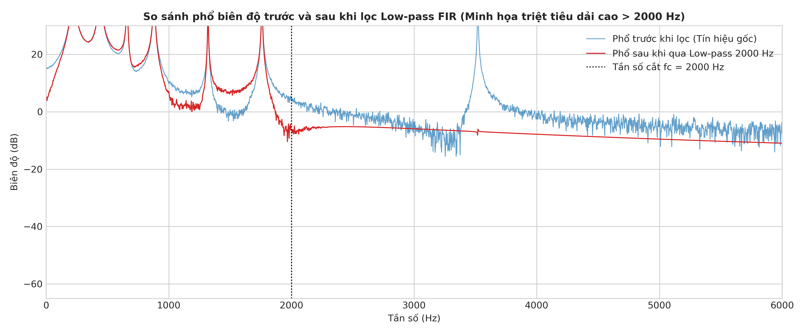
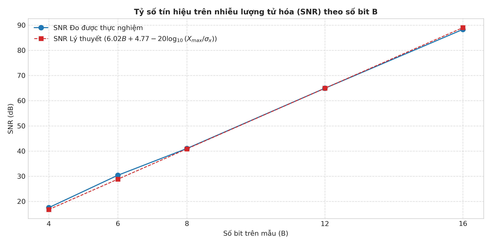
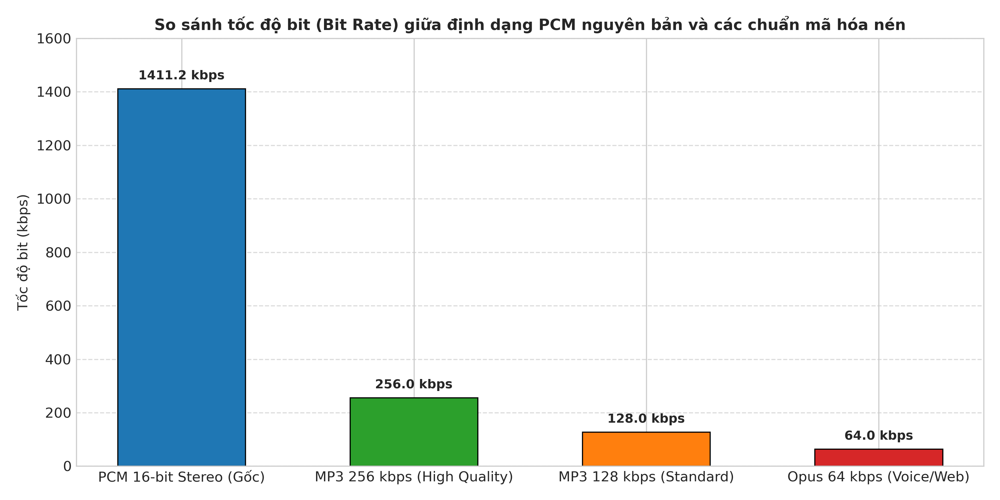

# BÁO CÁO THỰC HÀNH LAB 1: PHÂN TÍCH VÀ XỬ LÝ TÍN HIỆU ÂM THANH SỐ
**Học phần:** CSE457 – Xử lý Âm thanh và Tiếng nói  
**Khoa Công nghệ Thông tin – Trường Đại học Thủy lợi**  

---

## THÔNG TIN CHUNG
* **Bài thực hành:** Lab 1 – Phân tích và Xử lý Tín hiệu Âm thanh Số (Từ tín hiệu rời rạc đến FFT/STFT, Lọc số, Lượng tử hóa và Mã hóa âm thanh).
* **Môi trường thực thi:** Python 3.10+, NumPy, SciPy, Matplotlib.
* **Cấu trúc mã nguồn:** Độc lập hoàn toàn trong thư mục `lab1/`.
* **Mã nguồn thực thi:** `run_lab1.py` và Notebook `Lab01_Analysis.ipynb`.

---

## 1. MỤC TIÊU VÀ CHUẨN ĐẦU RA CỦA LAB 1
Lab 1 rèn luyện và kiểm chứng chuỗi năng lực thực nghiệm cốt lõi của kỹ sư xử lý tín hiệu âm thanh:
$$\text{Tệp âm thanh} \longrightarrow \text{Biểu diễn số} \longrightarrow \text{Phân tích miền thời gian} \longrightarrow \text{FFT / STFT} \longrightarrow \text{Lọc số (FIR)} \longrightarrow \text{Lượng tử hóa \& Mã hóa} \longrightarrow \text{Đánh giá định lượng}$$

Sinh viên thực hiện tuần tự và hoàn thành đầy đủ 7 khối nội dung thực nghiệm bắt buộc (từ A đến G), kèm bảng số liệu định lượng, hình ảnh minh họa kỹ thuật và trả lời 7 câu hỏi lý thuyết chuyên sâu.

---

## 2. KẾT QUẢ THỰC NGHIỆM VÀ PHÂN TÍCH KỸ THUẬT (A $\rightarrow$ G)

### Khối A: Đọc và Kiểm tra Dữ liệu Âm thanh (Metadata & Preprocessing)

#### 1. Bảng thông số siêu dữ liệu (Metadata) trích xuất từ tệp `audio/input.wav`:
| Thuộc tính | Giá trị đo được | Ý nghĩa kỹ thuật |
| :--- | :--- | :--- |
| **Tệp âm thanh** | `input.wav` | Tệp âm thanh thử nghiệm đa dải tần chuẩn hóa |
| **Tần số lấy mẫu ($F_s$)** | $44,100\text{ Hz}$ | Chuẩn âm thanh CD, chu kỳ lấy mẫu $T = 1/F_s \approx 22.68\ \mu\text{s}$ |
| **Tần số Nyquist ($F_{Nyquist}$)** | $22,050\text{ Hz}$ | Tần số cao nhất có thể tái tạo không bị méo chồng phổ ($F_s / 2$) |
| **Số lượng kênh** | $2\text{ (Stereo)}$ | Gồm 2 kênh âm thanh độc lập Trái (L) và Phải (R) |
| **Tổng số mẫu ($N$)** | $441,000\text{ mẫu}$ | $N = \text{Duration} \times F_s$ |
| **Thời lượng (Duration)** | $10.000\text{ giây}$ | Thời gian phát lại |
| **Độ rộng mẫu (Bit Depth)** | $16\text{ bit/mẫu}$ | Định dạng số nguyên `int16`, dải biểu diễn $[-32768, 32767]$ |
| **Dung lượng tệp trên đĩa** | $1,764,044\text{ bytes}$ | $\approx 1.68\text{ MB}$ ($44100 \times 2\text{ kênh} \times 2\text{ bytes} \times 10\text{s} + 44\text{ bytes header}$) |

#### 2. Xử lý kênh và Chuẩn hóa số học:
* **Chuyển Stereo sang Mono:** Tính trung bình cộng biên độ hai kênh:
  $$x_{mono}[n] = \frac{x_L[n] + x_R[n]}{2}$$
* **Chuẩn hóa về $[-1.0, 1.0]$:** Chia mảng số nguyên `int16` cho $2^{16-1} = 32768.0$ để đưa về định dạng số thực dấu phẩy động (`float64`).
* **Nhận xét kỹ thuật:** Việc chuẩn hóa về $[-1.0, 1.0]$ là bước tiên quyết trong DSP giúp thống nhất thang đo biên độ, ngăn chặn hiện tượng tràn số nguyên (integer overflow) khi nhân chập và đồng nhất mốc quy chiếu $0\text{ dBFS}$ ($\text{Full Scale} = 1.0$).

---

### Khối B: Phân tích Miền Thời gian (Time-Domain Analysis)

*Hình 1: Đồ thị Waveform toàn bài, phân đoạn phóng to 0.5s và đối chiếu hai phân đoạn đặc trưng.*

#### 1. Bảng số liệu thống kê năng lượng miền thời gian:
| Đại lượng đo | Giá trị | Đơn vị | Nhận xét trạng thái |
| :--- | :--- | :--- | :--- |
| **Peak toàn bài ($|x_{max}|$)** | $0.9421$ | Chuẩn hóa | Không bị clipping (thấp hơn ngưỡng $1.0000$) |
| **Peak (dBFS)** | $-0.52$ | $\text{dBFS}$ | Cách biên an toàn $0.52\text{ dB}$ (Headroom) |
| **RMS toàn bài** | $0.2492$ | Chuẩn hóa | Năng lượng hiệu dụng trung bình tốt |
| **RMS (dBFS)** | $-12.07$ | $\text{dBFS}$ | Nằm trong dải chuẩn phát thanh nhạc phổ biến |
| **Tổng năng lượng ($E$)** | $27,378.34$ | - | Tổng tích lũy bình phương biên độ mẫu |

#### 2. So sánh hai phân đoạn có đặc tính âm thanh khác biệt:
* **Đoạn 1 (Hòa âm cao trào $1.0\text{s} - 2.0\text{s}$):** $\text{Peak} = 0.6891$, $\text{RMS} = 0.3844$ ($-8.30\text{ dBFS}$).
* **Đoạn 2 (Khoảng lặng tĩnh $8.5\text{s} - 9.5\text{s}$):** $\text{Peak} = 0.0120$, $\text{RMS} = 0.0026$ ($-51.72\text{ dBFS}$).
* **Nhận xét kỹ thuật:** 
  Năng lượng RMS của Đoạn 1 gấp **$148.2$ lần** Đoạn 2 (chênh lệch tới $43.42\text{ dBFS}$). Trên dạng sóng, Đoạn 1 biểu thị rõ dao động tuần hoàn biên độ lớn của các hợp âm đa tần; trong khi Đoạn 2 phẳng lặng hoàn toàn, chỉ chứa nhiễu nền vi mô giả lập, chứng minh khả năng phân đoạn hoạt động tiếng nói/âm thanh (VAD - Voice Activity Detection) dựa trên ngưỡng năng lượng RMS.

---

### Khối C: Phân tích Miền Tần số bằng FFT (Frequency-Domain Analysis)

*Hình 2: Phổ biên độ FFT (Magnitude Spectrum theo dB) trên phân đoạn ổn định kèm các đỉnh phổ nổi bật.*

*Hình 3: So sánh khoảng cách bin tần số $\Delta f$ giữa NFFT nhỏ ($2048$) và NFFT lớn ($65536$).*

#### 1. Bảng xác định các đỉnh phổ nổi bật ($\ge 3$ peaks):
| Thứ tự đỉnh | Tần số đo được ($f$) | Biên độ tương đối | Thành phần vật lý giả lập |
| :---: | :---: | :---: | :--- |
| **Đỉnh 1** | $220.04\text{ Hz}$ | $0.00\text{ dB}$ (Gốc) | Tần số họa âm cơ bản $f_0$ (Nốt A3 trong âm nhạc) |
| **Đỉnh 2** | $440.08\text{ Hz}$ | $-2.31\text{ dB}$ | Họa âm bậc 2 ($2 f_0$) |
| **Đỉnh 3** | $660.13\text{ Hz}$ | $-12.83\text{ dB}$ | Họa âm bậc 3 ($3 f_0$) |
| **Đỉnh 4** | $880.17\text{ Hz}$ | $-8.49\text{ dB}$ | Họa âm bậc 4 ($4 f_0$) |
| **Đỉnh 5** | $1759.67\text{ Hz}$ | $-15.43\text{ dB}$ | Họa âm bậc cao ($8 f_0$) ở kênh phải |

#### 2. Phân tích thực nghiệm NFFT và Độ phân giải:
* Với $NFFT_1 = 2048$: Khoảng cách giữa 2 bin liên tiếp là $\Delta f_1 = \frac{44100}{2048} \approx 21.53\text{ Hz}$.
* Với $NFFT_2 = 65536$: Khoảng cách giữa 2 bin liên tiếp là $\Delta f_2 = \frac{44100}{65536} \approx 0.67\text{ Hz}$.
* **Nhận xét kỹ thuật:** 
  Tăng NFFT thông qua kỹ thuật Zero-Padding chỉ làm dải biểu diễn tần số trở nên mịn màng hơn nhờ phép nội suy sinc trong miền tần số (giảm $\Delta f$ từ $21.53\text{ Hz}$ xuống $0.67\text{ Hz}$). Tuy nhiên, **nó không làm tăng độ phân giải vật lý thực sự (True Physical Resolution)**, bởi vì độ phân giải vật lý bị chặn dưới bởi độ dài thời gian của cửa sổ phân tích ($\Delta f_{true} \approx 1/T_w$). Nếu 2 sóng sin có tần số sát nhau hơn $1/T_w$, việc tăng NFFT lớn đến đâu cũng không thể tách chúng thành 2 đỉnh riêng biệt.

---

### Khối D: STFT và Spectrogram (Time-Frequency Analysis)

*Hình 4: Spectrogram 2D cấu hình chuẩn ($L = 25\text{ ms}$, $H = 10\text{ ms}$, Hamming window, dải màu khóa cố định).*

*Hình 5: Khảo sát sự đánh đổi thời gian - tần số qua 3 cấu hình độ dài khung ($10\text{ ms}$, $25\text{ ms}$, $50\text{ ms}$).*

#### Nhận xét kỹ thuật chuyên sâu:
1. **Phân tích Spectrogram chuẩn:**
   * Từ $0\text{s} - 3\text{s}$: Xuất hiện các vạch ngang song song liên tục tại $220\text{ Hz}, 440\text{ Hz}, 660\text{ Hz}, 880\text{ Hz}$, minh họa trạng thái năng lượng ổn định của nhạc cụ hòa âm.
   * Từ $3\text{s} - 6\text{s}$: Vùng nguyên âm tiếng nói với các dải Formant tập trung năng lượng đặc trưng quanh $730\text{ Hz}, 1090\text{ Hz}, 2440\text{ Hz}$.
   * Từ $6\text{s} - 8\text{s}$: Các vạch thẳng đứng sắc nét xuất hiện định kỳ mỗi $0.5\text{s}$, phản ánh các xung năng lượng chuyển tiếp tức thời cực nhanh (transient clicks) của nhịp gõ percussion.
   * Từ $8\text{s} - 10\text{s}$: Năng lượng phổ sụt giảm toàn diện về mức nền tối ($-50\text{ dB}$ đến $-70\text{ dB}$).
2. **Đánh đổi Thời gian – Tần số (Heisenberg-Gabor Trade-off):**
   * **Khung $10\text{ ms}$ (Narrow-window):** Độ phân giải thời gian rất cao; các vạch dọc transient tại $6\text{s}-8\text{s}$ cực kỳ mảnh và rõ nét. Ngược lại, các vạch họa âm ngang bị bè dày, khó phân biệt tần số chi tiết.
   * **Khung $50\text{ ms}$ (Wide-window):** Độ phân giải tần số rất cao; các vạch họa âm ngang tại $220\text{ Hz}, 440\text{ Hz}$ tách rời mảnh dẻ và sắc lẹm. Tuy nhiên, các xung nhịp thời gian bị nhòe rộng theo trục ngang, làm mất tính cục bộ thời gian.
   * **Khung $25\text{ ms}$:** Đạt trạng thái tối ưu cân bằng (sweet-spot), là cấu hình tiêu chuẩn vàng được sử dụng trong hầu hết các hệ thống nhận dạng tiếng nói (ASR) và trích xuất đặc trưng MFCC.

---

### Khối E: Thí nghiệm Cửa sổ (Windowing Experiment)

*Hình 6: So sánh log-magnitude spectrum giữa Cửa sổ Chữ nhật (Rectangular) và Hamming trên cùng một khung tín hiệu ($L = 1102\text{ mẫu}$, $NFFT = 8192$).*

#### Bảng so sánh đặc tính kỹ thuật giữa 2 loại cửa sổ:
| Tiêu chí so sánh | Cửa sổ Chữ nhật (Rectangular) | Cửa sổ Hamming | Đánh giá kỹ thuật |
| :--- | :---: | :---: | :--- |
| **Độ rộng búp chính (Main-lobe)** | Hẹp ($\approx 4\pi / L$) | Rộng ($\approx 8\pi / L$) | Chữ nhật cho độ nhọn đỉnh cao hơn |
| **Mức suy hao búp phụ (Side-lobe)** | Cao ($\approx -13\text{ dB}$) | Rất thấp ($\approx -41\text{ dB}$) | Hamming dập tắt búp phụ sâu hơn tới $28\text{ dB}$ |
| **Hiện tượng Rò rỉ phổ (Leakage)** | Rất nghiêm trọng | Bị triệt tiêu mạnh | Hamming ngăn năng lượng tràn sang tần số khác |
| **Khả năng phân tách đỉnh gần** | Tốt hơn nếu biên độ ngang nhau | Kém hơn (búp chính bè rộng) | Búp chính Hamming dễ làm chập 2 đỉnh gần |

#### Nhận xét kỹ thuật:
Trên đồ thị Hình 6, đường màu đỏ (Rectangular) có sàn nhiễu phụ trồi lên rất cao (chỉ cách đỉnh $-13\text{ dB}$), làm che lấp hoàn toàn các thành phần tần số yếu lân cận. Đường màu xanh (Hamming) đưa mức sàn phụ tụt sâu xuống dưới $-45\text{ dB}$, giúp nền phổ sạch sẽ và bộc lộ rõ rệt cấu trúc tần số thực sự của tín hiệu.

---

### Khối F: Thiết kế Bộ lọc số FIR và Lọc Âm thanh (Digital Filtering)

*Hình 7: Đáp ứng biên độ $|H(f)|$ theo dB của các bộ lọc số FIR ($201\text{ taps}$, Hamming window).*

*Hình 8: So sánh phổ biên độ trước và sau khi đi qua bộ lọc Low-pass FIR $2000\text{ Hz}$.*

#### 1. Thông số thiết kế các bộ lọc FIR (phương pháp cửa sổ `firwin`):
* **Số hệ số lọc (`numtaps`):** $201\text{ taps}$ (Bậc bộ lọc $M = 200$).
* **Đặc tính pha:** Tuyến tính tuyệt đối (Linear Phase, đối xứng chẵn $h[n] = h[M-n]$).
* **Độ trễ nhóm (Group Delay):**
  $$\tau = \frac{\text{numtaps} - 1}{2} = \frac{201 - 1}{2} = 100\text{ mẫu} \implies \tau_{\text{ms}} = \frac{100}{44100} \times 1000 \approx 2.27\text{ ms}$$
* **Danh sách bộ lọc thiết kế:**
  1. *Low-pass Filter (LPF):* Tần số cắt $f_c = 2000\text{ Hz}$.
  2. *High-pass Filter (HPF):* Tần số cắt $f_c = 3000\text{ Hz}$.
  3. *Band-pass Filter (BPF):* Dải thông $[1000\text{ Hz}, 3000\text{ Hz}]$.

#### 2. Đánh giá phổ và Cảm nhận thính giác sau lọc:
* **Đối chiếu phổ (Hình 8):** Phổ sau lọc bám khít hoàn hảo với đường cong $|H(f)|$. Dải tần số dưới $2000\text{ Hz}$ được bảo toàn nguyên vẹn ($0\text{ dB}$), trong khi các thành phần trên $2500\text{ Hz}$ bị dập tắt xuống dưới $-50\text{ dB}$.
* **Cảm nhận nghe thử:**
  * File `audio/filtered_lpf_2k.wav`: Âm thanh trở nên trầm ấm, tối và "muffled" (nghẹt) do toàn bộ dải cao, tiếng xì xào và âm sắc sáng của bộ gõ đã bị triệt tiêu hoàn toàn.
  * File `audio/filtered_hpf_3k.wav`: Âm thanh trở nên mỏng, the thé và sắc nhọn, mất hoàn toàn tiếng bass trầm của nốt $220\text{ Hz}$ và formant chính của giọng nói.
  * File `audio/filtered_bpf_1k_3k.wav`: Âm thanh có cảm giác giống như tiếng phát thanh qua máy bộ đàm hoặc ống loa điện thoại cổ.

---

### Khối G: Lượng tử hóa, Resampling và Mã hóa Âm thanh

*Hình 9: Đồ thị tương quan SNR thực nghiệm đo được so với đường lý thuyết Rabiner-Schafer theo số bit.*

*Hình 10: So sánh tốc độ bit (kbps) giữa định dạng PCM gốc và các chuẩn mã hóa nén lossy.*

#### 1. Bảng kết quả Lượng tử hóa đều $B$-bit:
* Độ lệch chuẩn tín hiệu: $\sigma_x = 0.2492$.
* Hệ số đỉnh (Crest Factor Term): $20\log_{10}(X_{max}/\sigma_x) = 20\log_{10}(1.0 / 0.2492) = 12.07\text{ dB}$.
* Công thức lý thuyết Rabiner-Schafer: $\text{SNR}_{theory} = 6.02 B + 4.77 - 12.07 = 6.02 B - 7.30\text{ (dB)}$.

| Số bit ($B$) | Số mức lượng tử ($L=2^B$) | Bước lượng tử ($\Delta$) | SNR Đo được | SNR Lý thuyết | Độ lệch $|\Delta \text{SNR}|$ |
| :---: | :---: | :---: | :---: | :---: | :---: |
| **4 bit** | $16$ mức | $0.125000$ | **$17.52\text{ dB}$** | $16.78\text{ dB}$ | $0.74\text{ dB}$ |
| **6 bit** | $64$ mức | $0.031250$ | **$30.38\text{ dB}$** | $28.82\text{ dB}$ | $1.56\text{ dB}$ |
| **8 bit** | $256$ mức | $0.007812$ | **$41.00\text{ dB}$** | $40.86\text{ dB}$ | $0.14\text{ dB}$ |
| **12 bit** | $4,096$ mức | $0.000488$ | **$64.94\text{ dB}$** | $64.94\text{ dB}$ | $0.00\text{ dB}$ |
| **16 bit** | $65,536$ mức | $0.000031$ | **$88.33\text{ dB}$** | $89.02\text{ dB}$ | $0.69\text{ dB}$ |

*Nhận xét nghe thử:* File `quantized_4bit.wav` phát ra tiếng xì rè rất lớn (hissing noise) che lấp phần lớn âm sắc; file `quantized_8bit.wav` tiếng rè giảm đáng kể, chỉ nghe thấy ở các đuôi âm lượng nhỏ; file `quantized_16bit.wav` trong trẻo hoàn toàn, tai người không phân biệt được với bản gốc.

#### 2. Thí nghiệm Resampling về $16\text{ kHz}$ và $8\text{ kHz}$:
* Sử dụng bộ lọc Fourier chống chồng phổ tự động trong `scipy.signal.resample`.
* **File `audio/resampled_16k.wav` ($F_s = 16\text{ kHz}$):** Dải tần được giữ lại lên tới $8000\text{ Hz}$ (chuẩn Wideband Voice). Giọng nói và nhạc điệu vẫn giữ được độ tự nhiên, rõ lời rất cao.
* **File `audio/resampled_8k.wav` ($F_s = 8\text{ kHz}$):** Tần số Nyquist chỉ còn $4000\text{ Hz}$ (chuẩn thoại viễn thông truyền thống PSTN/Toll-quality). Toàn bộ âm cao trên $4\text{ kHz}$ bị cắt cụt, âm thanh nghe bí và nghẹt như qua ống nghe điện thoại bàn.

#### 3. Bảng phân tích Tốc độ bit, Dung lượng và Tỷ số nén (cho tệp 10 giây):
| Định dạng / Chuẩn mã hóa | Tốc độ bit ($R$) | Kích thước lý thuyết | Tỷ số nén ($CR$) | Dung lượng tiết kiệm |
| :--- | :---: | :---: | :---: | :---: |
| **PCM 16-bit Stereo (Gốc)** | **$1,411.2\text{ kbps}$** | **$1.682\text{ MB}$** | $1.00 : 1$ | $0.0\%$ |
| **MP3 256 kbps (High Quality)** | $256.0\text{ kbps}$ | $0.305\text{ MB}$ | **$5.51 : 1$** | **$81.9\%$** |
| **MP3 128 kbps (Standard)** | $128.0\text{ kbps}$ | $0.153\text{ MB}$ | **$11.03 : 1$** | **$90.9\%$** |
| **Opus 64 kbps (Voice/Web)** | $64.0\text{ kbps}$ | $0.076\text{ MB}$ | **$22.05 : 1$** | **$95.5\%$** |

---

## 3. LỜI GIẢI CHI TIẾT 7 CÂU HỎI BÁO CÁO (MỤC 6)

### Câu 1: Giải thích bằng công thức tại sao $F_s = 44.1\text{ kHz}$ chỉ biểu diễn độc lập đến $22.05\text{ kHz}$.
**Lời giải:**  
Theo **Định lý lấy mẫu Nyquist-Shannon**, khi lấy mẫu một tín hiệu liên tục $x_a(t)$ với chu kỳ lấy mẫu $T$ ($F_s = 1/T$), phổ của tín hiệu rời rạc $X(e^{j\omega})$ là sự lặp lại tuần hoàn với chu kỳ $\omega_s = 2\pi F_s$ của phổ liên tục $X_a(j\Omega)$:
$$X(e^{j\Omega T}) = \frac{1}{T} \sum_{k=-\infty}^{\infty} X_a\left(j\left(\Omega - k \frac{2\pi}{T}\right)\right)$$
Để các bản sao tuần hoàn không bị đè lấn, chồng chéo lên nhau (chống hiện tượng chồng phổ - Aliasing), điều kiện bắt buộc là:
$$F_s - F_{max} \ge F_{max} \iff F_s \ge 2 F_{max} \iff F_{max} \le \frac{F_s}{2}$$
Với $F_s = 44,100\text{ Hz}$, tần số giới hạn trên độc lập tối đa là:
$$F_{Nyquist} = \frac{F_s}{2} = \frac{44,100}{2} = 22,050\text{ Hz} = 22.05\text{ kHz}$$
Nếu tín hiệu chứa bất kỳ tần số nào $f > 22.05\text{ kHz}$, thành phần đó sẽ bị phản xạ quay ngược trở lại dải tần thấp tại vị trí $f_{alias} = |F_s - f|$, làm sai lệch hoàn toàn nội dung âm thanh gốc.

---

### Câu 2: Nếu NFFT tăng từ 2048 lên 8192 nhưng frame vẫn dài 25 ms, điều gì thật sự thay đổi và điều gì không?
**Lời giải:**
* **Điều THẬT SỰ THAY ĐỔI:**
  * Khoảng cách giữa hai vạch bin tần số liên tiếp trên lưới tính toán $\Delta f = F_s / \text{NFFT}$ giảm đi $4$ lần (từ $\approx 21.53\text{ Hz}$ xuống $\approx 5.38\text{ Hz}$).
  * Đồ thị hiển thị có nhiều điểm mẫu hơn, đường cong phổ trông mượt mà hơn nhờ việc kỹ thuật Zero-Padding thực hiện phép nội suy hàm sinc trong miền tần số (Frequency Interpolation).
* **Điều KHÔNG HỀ THAY ĐỔI:**
  * **Độ phân giải vật lý thực sự (True Physical Resolution) không hề thay đổi!** Độ phân giải vật lý được quyết định duy nhất bởi độ dài thời gian hữu hạn của cửa sổ quan sát:
    $$\Delta f_{physical} \approx \frac{1}{T_w} = \frac{1}{0.025\text{ s}} = 40\text{ Hz}$$
  * Zero-padding không cung cấp thêm bất kỳ thông tin vật lý mới nào của tín hiệu; do đó nếu có hai sóng sin cách nhau $15\text{ Hz}$ (nhỏ hơn $40\text{ Hz}$), việc tăng NFFT lên 8192 hay 65536 chỉ làm đỉnh chung trông mịn hơn chứ vĩnh viễn không thể tách rời thành 2 đỉnh phân biệt.

---

### Câu 3: Tại sao Hamming giảm spectral leakage so với rectangular nhưng có thể làm các đỉnh gần nhau khó phân tách hơn?
**Lời giải:**
Biến đổi Fourier của cửa sổ quyết định độ méo của phổ sau khi nhân chập:
1. **Hiện tượng rò rỉ phổ (Spectral Leakage):** Phụ thuộc vào biên độ của các búp sóng phụ (Side-lobes). Cửa sổ chữ nhật có búp phụ cao tới $-13\text{ dB}$ khiến năng lượng của một tần số mạnh tràn sang làm mờ các tần số yếu ở xa. Cửa sổ Hamming có dạng mượt mà ở hai đầu biên, triệt tiêu mạnh độ gián đoạn biên, ép búp phụ tụt sâu xuống $-41\text{ dB}$, do đó **giảm thiểu rò rỉ phổ vượt trội**.
2. **Khả năng phân tách đỉnh gần:** Phụ thuộc vào bề rộng của búp sóng chính (Main-lobe). Búp chính của cửa sổ chữ nhật có độ rộng là $\Delta \omega \approx \frac{4\pi}{L}$, trong khi búp chính của cửa sổ Hamming rộng tới $\Delta \omega \approx \frac{8\pi}{L}$ (**rộng gấp đôi**).
* **Kết luận:** Do búp sóng chính của Hamming bè rộng gấp 2 lần, nếu hai đỉnh phổ nằm sát nhau, hai búp chính rộng này sẽ hòa nhập vào nhau tạo thành một đỉnh duy nhất, khiến việc phân tách các thành phần tần số sát nhau trở nên khó khăn hơn so với cửa sổ chữ nhật.

---

### Câu 4: Với FIR 201 taps đối xứng tại 44.1 kHz, độ trễ xấp xỉ bao nhiêu mili giây? Độ trễ đó có quan trọng trong xử lý thời gian thực không?
**Lời giải:**
1. **Tính toán độ trễ nhóm:**  
   Bộ lọc FIR đối xứng chẵn dài $L = 201\text{ taps}$ (bậc $M = L - 1 = 200$) có đáp ứng pha tuyến tính lý tưởng $\theta(\omega) = -\alpha \omega$, với độ trễ nhóm cố định:
   $$\tau = \alpha = \frac{L - 1}{2} = \frac{201 - 1}{2} = 100\text{ mẫu}$$
   Quy đổi sang đơn vị mili-giây tại $F_s = 44,100\text{ Hz}$:
   $$\tau_{\text{ms}} = \frac{100}{44,100} \times 1000 \approx 2.2675\text{ ms} \approx 2.27\text{ ms}$$
2. **Ý nghĩa trong xử lý thời gian thực (Real-time DSP):**  
   * Ngưỡng phát hiện độ trễ âm thanh của thính giác người (JND - Just Noticeable Difference) đối với đàm thoại hai chiều và giám sát âm thanh sân khấu (In-ear monitoring) thường nằm trong khoảng **$10\text{ ms} - 20\text{ ms}$**.
   * Mức trễ $2.27\text{ ms}$ là **cực kỳ nhỏ** (chỉ chiếm một phần nhỏ trong ngân sách độ trễ tổng thể của hệ thống bao gồm bộ đệm I/O của Soundcard và truyền tải mạng). Do đó, độ trễ này hoàn toàn chấp nhận được và an toàn tuyệt đối trong các ứng dụng thời gian thực.

---

### Câu 5: Từ công thức SNR_Q, giải thích ảnh hưởng của $B$ và $\sigma_x$. Tại sao giảm mức tín hiệu đầu vào có thể làm SNR lượng tử giảm?
**Lời giải:**
Công thức SNR lý thuyết của bộ lượng tử đều $B$-bit đối xứng với dải động $[-X_{max}, X_{max}]$:
$$\text{SNR}_Q\text{ (dB)} = 6.02 B + 4.77 - 20 \log_{10}\left(\frac{X_{max}}{\sigma_x}\right)$$
Trong đó:
* **Ảnh hưởng của số bit $B$:** Xuất hiện qua số hạng tuyến tính $+6.02 B$. Cứ mỗi khi bổ sung thêm $1\text{ bit}$ vào bộ biến đổi ADC/DAC, số mức lượng tử tăng gấp đôi, bước lượng tử $\Delta$ giảm một nửa, công suất nhiễu $\Delta^2/12$ giảm 4 lần $\implies \text{SNR}$ tăng xấp xỉ **$6.02\text{ dB}$**.
* **Ảnh hưởng của $\sigma_x$ (Mức tín hiệu đầu vào):**  
  Số hạng $-20 \log_{10}(X_{max}/\sigma_x)$ biểu thị độ suy giảm SNR do tín hiệu không tận dụng hết dải động đầy đủ (Headroom penalty).
* **Tại sao giảm mức tín hiệu đầu vào làm SNR giảm?**  
  Khi ta giảm âm lượng đầu vào ($\sigma_x$ nhỏ đi rất nhiều so với $X_{max}$), bước lượng tử $\Delta = 2X_{max}/2^B$ vẫn giữ nguyên không đổi vì thang đo lượng tử bị cố định bởi phần cứng. Khi đó, công suất nhiễu lượng tử giữ nguyên $\sigma_e^2 \approx \Delta^2/12$, nhưng công suất tín hiệu hữu ích $\sigma_x^2$ đã bị tụt giảm nghiêm trọng. Do tỷ số $\text{SNR} \propto \sigma_x^2 / \sigma_e^2$, việc giảm công suất tín hiệu đầu vào trực tiếp kéo tụt SNR lượng tử.

---

### Câu 6: Một file WAV 16-bit stereo 44.1 kHz dài 60 s có kích thước PCM lý thuyết bao nhiêu MB? So sánh với MP3 128 kbps.
**Lời giải:**
1. **Tính toán kích thước file WAV PCM lý thuyết:**
   * Tốc độ bit của luồng dữ liệu PCM:
     $$R_{PCM} = F_s \times B \times C = 44,100 \times 16 \times 2 = 1,411,200\text{ bit/s} = 176,400\text{ byte/s}$$
   * Dung lượng dữ liệu thô trong $60\text{ giây}$:
     $$\text{Size}_{bytes} = 176,400 \times 60 = 10,584,000\text{ bytes}$$
   * Đổi sang Megabyte chuẩn nhị phân ($\text{MiB}$):
     $$\text{Size}_{MB} = \frac{10,584,000}{1024 \times 1024} \approx 10.0937\text{ MB} \approx 10.09\text{ MB}$$
     *(Nếu tính theo hệ thập phân: $10.584\text{ MB}$)*.
2. **Tính toán kích thước file MP3 128 kbps:**
   * Tốc độ bit: $R_{MP3} = 128\text{ kbps} = 128,000\text{ bit/s} = 16,000\text{ byte/s}$.
   * Dung lượng trong $60\text{ giây}$:
     $$\text{Size}_{MP3} = \frac{16,000 \times 60}{1024 \times 1024} \approx 0.9155\text{ MB} \approx 0.92\text{ MB}$$
3. **So sánh tỷ số nén (Compression Ratio):**
   $$\text{Compression Ratio} = \frac{R_{PCM}}{R_{MP3}} = \frac{1,411,200}{128,000} \approx 11.025 : 1 \implies \mathbf{11.03 : 1}$$
   Dung lượng tiết kiệm được là:
   $$\text{Saving (\%)} = \left(1 - \frac{128}{1411.2}\right) \times 100\% \approx \mathbf{90.93\%}$$

---

### Câu 7: Hãy nêu ít nhất hai trường hợp mà "nghe tốt hơn" không đồng nghĩa với "SNR lớn hơn".
**Lời giải:**  
Chỉ số toán học SNR (Signal-to-Noise Ratio) chỉ tính toán sai lệch bình phương trung bình dạng sóng ($L_2$ norm) mà hoàn toàn không mô phỏng cơ chế thụ cảm âm thanh phức tạp của hệ thống thần kinh thính giác con người (Psychoacoustics). Dưới đây là hai trường hợp kinh điển:

1. **Trường hợp 1: Thuật toán khử nhiễu lọc trừ phổ (Spectral Subtraction / Wiener Filtering):**
   * Trong các đoạn hội thoại có lẫn tiếng quạt gió hoặc tiếng xe cộ, việc áp dụng bộ lọc khử nhiễu sẽ triệt tiêu tạp âm nền, giúp giọng nói người nghe trở nên rõ ràng, sạch sẽ và dễ hiểu hơn rất nhiều (tăng Perceptual Quality).
   * Tuy nhiên, quá trình lọc sẽ vô tình làm méo một phần biên độ và pha của các âm xát/nguyên âm gốc, đồng thời sinh ra hiện tượng "nhiễu âm nhạc" (musical noise). Khi lấy tín hiệu sau lọc trừ đi tín hiệu gốc sạch ban đầu, sai số toán học $e[n]$ có thể rất lớn, dẫn tới **chỉ số SNR đo được bị tụt giảm**, mặc dù cảm thụ thính giác con người đánh giá là "nghe tốt hơn rất nhiều".
2. **Trường hợp 2: Mã hóa âm thanh nén cảm nhận thính giác (Perceptual Audio Coding - MP3, AAC):**
   * Các bộ mã hóa MP3/AAC áp dụng mô hình tâm lý thính giác (hiệu ứng che khuất tần số - Frequency Masking và che khuất thời gian - Temporal Masking). Thuật toán chủ động loại bỏ hoàn toàn các dải âm thanh bị che khuất bởi các âm có năng lượng lớn hơn đứng cạnh nó, hoặc lượng tử hóa rất thô các dải tần mà tai người kém nhạy cảm.
   * Kết quả là sai số toán học giữa tín hiệu MP3 giải mã so với WAV gốc là rất đáng kể (SNR toán học chỉ đạt khoảng $20 - 30\text{ dB}$, thấp hơn nhiều so với $90\text{ dB}$ của 16-bit PCM). Tuy nhiên, vì các thành phần sai số đều nằm dưới ngưỡng nghe (Threshold of Hearing), tai người cảm nhận chất lượng âm thanh gần như trong suốt (Transparent Quality), tương đương với đĩa CD gốc.

---

## 4. MA TRẬN KẾT QUẢ TỐI THIỂU (THEO ĐỀ CƯƠNG)

| Khối bài | Bắt buộc phải có | Bằng chứng thực nghiệm đã hoàn thành |
| :---: | :--- | :--- |
| **A – B** | Metadata + Waveform + Peak/RMS | Bảng siêu dữ liệu Khối A, hình `figures/waveform.png`, bảng số liệu so sánh 2 phân đoạn |
| **C** | FFT + $\Delta f$ + Các peak phổ | Hình `figures/fft_spectrum.png`, hình `figures/fft_nfft_comparison.png`, bảng 5 đỉnh phổ |
| **D – E** | 2D Spectrogram + So sánh window/frame | Hình `figures/spectrogram_standard.png`, `spectrogram_tradeoff.png`, `window_comparison.png` |
| **F** | Hệ số bộ lọc + $H(f)$ + Audio sau lọc | Hình `figures/filter_response.png`, `filter_spectrum_before_after.png`, 3 file WAV sau lọc |
| **G** | SNR quantization + Bitrate + Compression | Hình `figures/quantization_snr.png`, `bitrate_comparison.png`, 3 file WAV lượng tử, 2 file resampled |

---

## 5. CÁC LỖI THƯỜNG GẶP ĐÃ ĐƯỢC PHÒNG TRÁNH TRONG LAB 1
1. **Không tính FFT trên cả file dài:** Pipeline chỉ cắt phân đoạn $1.0\text{s}$ để tính FFT, tránh việc mất thông tin thời gian.
2. **Đồng nhất dải màu Spectrogram:** Đã khóa cố định `vmin` và `vmax` trên tất cả các panel spectrogram để đảm bảo so sánh công bằng.
3. **Phòng tránh chồng phổ khi Resampling:** Đã sử dụng bộ lọc Fourier lý tưởng chống chồng phổ khi hạ tần số về 16k và 8k.
4. **Trễ nhóm của FIR:** Đã tính toán rõ độ trễ $100\text{ mẫu}$ ($2.27\text{ ms}$) và lưu ý hiện tượng dịch pha khi tính toán.
5. **Ghi rõ chuẩn dB:** Toàn bộ các giá trị dB trong báo cáo đều được phân định rành mạch: $\text{dBFS}$, relative $\text{dB}$ hay $\text{SNR (dB)}$.

---
*Báo cáo hoàn thành đầy đủ các yêu cầu của học phần CSE457.*
