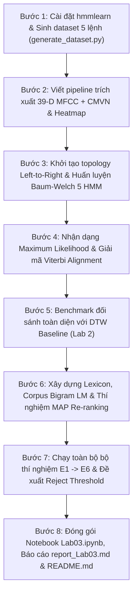

# KẾ HOẠCH TRIỂN KHAI THỰC HÀNH LAB 3
## NHẬN DẠNG TIẾNG NÓI NÂNG CAO VỚI HMM (HIDDEN MARKOV MODEL)
**Học phần:** CSE457 – Xử lý Âm thanh và Tiếng nói  
**Bộ môn:** Trí tuệ Nhân tạo – Khoa Công nghệ Thông tin – Trường Đại học Thủy lợi  
**Sinh viên thực hiện:** Nguyễn Văn Đạt  
**Mục tiêu tài liệu:** Bản kế hoạch chi tiết (Master Plan) định hướng thiết kế kiến trúc, phân rã mô-đun, kế hoạch thí nghiệm và tiêu chuẩn hoàn thiện sản phẩm theo chuẩn Rubric 10 điểm.

---

## I. TỔNG QUAN VÀ BỐI CẢNH KỸ THUẬT

### 1. Sự chuyển dịch mô hình: Từ DTW (Lab 2) sang HMM (Lab 3)
* **Lab 2 (DTW):** Phương pháp tiếp cận dựa trên mẫu (template-based / deterministic). So khớp trực tiếp chuỗi vector đặc trưng bằng quy hoạch động tìm khoảng cách nhỏ nhất trên đường căn chỉnh thời gian (warping path).
  - *Hạn chế:* Nhạy cảm với người nói khác biệt, không học được quy luật phân bố thống kê từ nhiều người nói, chi phí tính toán tăng tuyến tính theo số lượng template lưu trữ, khó mở rộng sang nhận dạng từ vựng lớn hoặc tiếng nói liên tục.
* **Lab 3 (Gaussian HMM):** Phương pháp tiếp cận thống kê (probabilistic / statistical generative model). Mô hình hóa đồng thời:
  1. **Động học biến thiên thời gian (Temporal dynamics):** Thông qua ma trận xác suất chuyển trạng thái $A = \{a_{ij}\}$ và giả thiết Markov bậc 1 (cấu trúc Left-to-Right phản ánh bản chất không đảo ngược của quá trình phát âm).
  2. **Biến thiên âm học (Acoustic variability):** Thông qua hàm mật độ xác suất phát xạ Gaussian liên tục nhiều chiều $B = \{b_i(x) = \mathcal{N}(x; \mu_i, \Sigma_i)\}$ mô tả phổ tần số của từng giai đoạn âm thanh.
  3. **Tích hợp ngữ cảnh (Contextual integration):** Mở đường ghép nối Lexicon (Từ điển phát âm) và Language Model (Mô hình ngôn ngữ N-gram) theo nguyên lý cực đại hóa xác suất hậu nghiệm Bayes (MAP).

### 2. Mô hình toán học cốt lõi
1. **Bài toán ASR theo Bayes (Bayesian Speech Recognition):**
   $$\hat{W} = \arg\max_{W} P(W|X) = \arg\max_{W} \frac{P(X|W) P(W)}{P(X)} = \arg\max_{W} \Big[ \log P(X|W) + \lambda_{LM} \log P(W) \Big]$$
   - $P(X|W)$: Acoustic model likelihood (được cung cấp bởi HMM).
   - $P(W)$: Language model prior (được cung cấp bởi Bigram LM).
   - $\lambda_{LM}$: Hệ số cân bằng thang điểm âm học và ngôn ngữ.
2. **Whole-word HMM Maximum Likelihood (Không có Prior):**
   $$\hat{w}_{ML} = \arg\max_{w} \log P(X | \lambda_w)$$
3. **Bộ tham số HMM $\lambda = (A, B, \pi)$:**
   - $\pi = [1, 0, \dots, 0]^T$: Trạng thái bắt đầu luôn là State 1.
   - $A$: Topology Left-to-Right không nhảy cóc ($a_{ii} \approx 0.7, a_{i,i+1} \approx 0.3, a_{NN} = 1.0$).
   - $B$: Phân bố Gaussian đơn $D = 39$ chiều với ma trận hiệp phương sai đường chéo (`covariance_type="diag"`):
     $$\mathcal{N}(x; \mu_i, \Sigma_i) = \frac{1}{(2\pi)^{D/2} |\Sigma_i|^{1/2}} \exp\left( -\frac{1}{2} (x - \mu_i)^T \Sigma_i^{-1} (x - \mu_i) \right)$$
4. **Ba bài toán cổ điển của HMM ứng dụng trong Lab 3:**
   - **Bài toán 1 (Evaluation / Likelihood):** Tính $P(X|\lambda)$ bằng thuật toán Forward $\alpha_t(j) = b_j(x_t) \sum_i \alpha_{t-1}(i) a_{ij}$.
   - **Bài toán 2 (Decoding / Alignment):** Tìm chuỗi trạng thái tối ưu $Q^* = (q_1^*, \dots, q_T^*)$ bằng thuật toán Viterbi $\delta_t(j) = b_j(x_t) \max_i [\delta_{t-1}(i) a_{ij}]$ và truy vết $\psi_t(j)$.
   - **Bài toán 3 (Learning / Training):** Tối ưu hóa tham số $(A, \mu, \Sigma)$ bằng giải thuật Baum-Welch (EM - Expectation Maximization) sử dụng xác suất Forward-Backward $\gamma_t(i)$ và $\xi_t(i, j)$.

---

## II. ĐẶC TẢ DỮ LIỆU VÀ CẤU TRÚC DỰ ÁN

### 1. Bộ dữ liệu đề xuất (5 lệnh tiếng Việt)
* **Từ vựng mục tiêu:** 5 lệnh điều khiển tách rời:
  - `mo` ("mở")
  - `dong` ("đóng")
  - `len` ("lên")
  - `xuong` ("xuống")
  - `dung` ("dừng")
  *(Hệ thống cũng hỗ trợ cấu hình chuyển đổi nhanh sang tập số `khong`, `mot`, `hai`, `ba`, `bon` kế thừa từ Lab 2 để thực hiện so sánh đối chuẩn chéo).*
* **Quy cách file âm thanh:**
  - Định dạng: WAV, Mono, $F_s = 16,000\text{ Hz}$, PCM 16-bit.
  - VAD / Padding: Có khoảng lặng tự nhiên $0.25 - 0.4\text{ s}$ ở hai đầu để kiểm thử thuật toán VAD/cắt silence.
* **Quy tắc phân chia tập dữ liệu (Dataset Partitioning):**
  - **Tập Train:** 6 file / lớp $\times$ 5 lớp = 30 file (Đặt trong `dataset/train/<label>/`).
  - **Tập Test:** 2 file / lớp $\times$ 5 lớp = 10 file (Đặt trong `dataset/test/<label>/`).
  - **Tập Mismatch (Speaker 2 / Noise):** Tối thiểu 10 file người nói khác nhằm phục vụ thí nghiệm mở rộng đánh giá độ bền vững (Robustness).
  - **Nguyên tắc vàng:** Phân tách hoàn toàn theo người nói / file độc lập, tuyệt đối không rò rỉ dữ liệu (No Data Leakage).

### 2. Cây cấu trúc thư mục mục tiêu `lab3/`
```text
Speech&Audio/lab3/
├── PLAN.md                     <- Tài liệu kế hoạch chi tiết này
├── README.md                   <- Hướng dẫn thiết lập môi trường, cấu trúc & lệnh chạy
├── requirements.txt            <- Danh sách thư viện cần thiết (hmmlearn, librosa, ...)
├── generate_dataset.py         <- Bộ sinh tập âm thanh 5 lệnh (Edge-TTS biến thiên + VAD)
├── record_dataset.py           <- Công cụ thu âm trực tiếp qua Microphone (nếu cần thu thật)
├── run_lab3.py                 <- Mã nguồn Python chạy toàn diện từ A -> H, xuất đồ thị và metrics
├── Lab03.ipynb                 <- Jupyter Notebook tương tác hoàn chỉnh theo luồng thực hành
├── report_Lab03.md             <- Báo cáo học thuật chi tiết 4-6 trang, giải quyết 10 câu hỏi 6.1
├── lexicon.txt                 <- Từ điển phát âm (Pronunciation Lexicon) định dạng WORD PHONE_1...
├── corpus.txt                  <- Ngữ liệu câu lệnh huấn luyện Bigram Language Model
├── dataset/                    <- Kho dữ liệu âm thanh chuẩn 16kHz
│   ├── train/
│   │   ├── mo/       (mo_01.wav -> mo_06.wav)
│   │   ├── dong/     (dong_01.wav -> dong_06.wav)
│   │   ├── len/      (len_01.wav -> len_06.wav)
│   │   ├── xuong/    (xuong_01.wav -> xuong_06.wav)
│   │   └── dung/     (dung_01.wav -> dung_06.wav)
│   ├── test/
│   │   ├── mo/       (mo_07.wav, mo_08.wav)
│   │   ├── dong/     (dong_07.wav, dong_08.wav)
│   │   └── ...
│   └── test_speaker2/          <- Dữ liệu kiểm thử mismatch người nói
├── models/                     <- Lưu trữ mô hình HMM đã huấn luyện (.pkl)
│   ├── hmm_mo.pkl
│   ├── hmm_dong.pkl
│   ├── hmm_len.pkl
│   ├── hmm_xuong.pkl
│   └── hmm_dung.pkl
├── figures/                    <- Hình ảnh đồ thị chất lượng cao phục vụ báo cáo
│   ├── fig1_mfcc39_heatmaps.png
│   ├── fig2_viterbi_alignment_mo.png
│   ├── fig3_viterbi_alignment_dong.png
│   ├── fig4_confusion_matrix_hmm.png
│   ├── fig5_dtw_vs_hmm_comparison.png
│   ├── fig6_lm_reranking_analysis.png
│   └── fig7_score_distributions_reject.png
└── results.csv                 <- Bảng tổng hợp số liệu định lượng các thí nghiệm E1 -> E6
```

---

## III. KẾ HOẠCH TRIỂN KHAI CHI TIẾT (TỪNG PHẦN A $\rightarrow$ H)

### Giai đoạn 1: Chuẩn bị Môi trường & Bộ Dữ liệu (Phần 2.1 & 2.2)
* **Nhiệm vụ 1.1:** Cài đặt thư viện còn thiếu: `pip install hmmlearn`.
  - Kiểm tra tính tương thích giữa `hmmlearn`, `scikit-learn` và `librosa`.
  - Xử lý các cảnh báo thay đổi API giữa các phiên bản (ví dụ khởi tạo `init_params` vs `params`).
* **Nhiệm vụ 1.2:** Xây dựng `generate_dataset.py` để tạo tập mẫu chuẩn:
  - Sinh 5 nhãn: `mo`, `dong`, `len`, `xuong`, `dung` với tối thiểu 8 utterance/nhãn (6 train, 2 test).
  - Tự động chèn khoảng lặng 0.25 - 0.4s ở hai đầu.
  - Tạo thêm biến thể người nói thứ 2 (`dataset/test_speaker2/`) để đánh giá Speaker Mismatch.

---

### Giai đoạn 2: Chuẩn hóa Dữ liệu & Trích xuất Đặc trưng 39 chiều (Phần 4.1 & 5.2 - Mục A)
* **Đặc tả pipeline trích xuất:**
  1. Đọc file WAV, đảm bảo mono và lấy mẫu đúng $F_s = 16,000\text{ Hz}$.
  2. Áp dụng VAD loại bỏ khoảng lặng không mang thông tin âm vị học: `librosa.effects.trim(y, top_db=30)`.
  3. Pre-emphasis lọc bù suy hao tần số cao: $y[n] = x[n] - 0.97 x[n-1]$.
  4. Trích xuất 13 hệ số MFCC tĩnh ($c_0 \dots c_{12}$) với khung $25\text{ ms}$ (400 mẫu), bước nhảy $10\text{ ms}$ (160 mẫu), cửa sổ Hamming, 26 bộ lọc Mel tam giác trong dải $[20\text{ Hz}, 8000\text{ Hz}]$.
  5. Tính toán đạo hàm bậc 1 ($\Delta$) và bậc 2 ($\Delta^2$) bằng hồi quy đa khung thời gian:
     $$\Delta c_t = \frac{\sum_{n=1}^N n (c_{t+n} - c_{t-n})}{2 \sum_{n=1}^N n^2}, \quad \Delta^2 c_t = \Delta(\Delta c_t)$$
  6. Ghép vector đặc trưng: $x_t = [c_t^T, \Delta c_t^T, \Delta^2 c_t^T]^T \in \mathbb{R}^{39}$, tạo ma trận $T \times 39$.
  7. Chuẩn hóa Utterance-level CMVN (Cepstral Mean & Variance Normalization):
     $$\hat{x}_t = \frac{x_t - \mu_X}{\sigma_X + 10^{-8}}$$
* **Kiểm tra & Trực quan hóa:**
  - Kiểm tra kích thước ma trận đặc trưng của các file mẫu: khẳng định chiều thứ 2 luôn là 39, số frame $T$ biến thiên linh hoạt.
  - Vẽ Heatmap trực quan hóa 39 chiều (13 MFCC tĩnh, 13 Delta, 13 Delta-Delta) của ít nhất 2 từ khác nhau (ví dụ: `mo` và `dong`), chỉ rõ sự tương phản về năng lượng và biến thiên phổ.

---

### Giai đoạn 3: Thiết kế & Khởi tạo HMM Trái-sang-phải (Phần 4.2 & 5.3 - Mục B)
* **Thiết lập Topology Left-to-Right (Bakis Model):**
  - Số trạng thái cơ bản: $N = 5$ states/word.
  - Vector xác suất ban đầu: $\pi = [1.0, 0.0, 0.0, 0.0, 0.0]^T$.
  - Ma trận chuyển trạng thái khởi tạo $A$:
    $$A = \begin{bmatrix}
    0.7 & 0.3 & 0 & 0 & 0 \\
    0 & 0.7 & 0.3 & 0 & 0 \\
    0 & 0 & 0.7 & 0.3 & 0 \\
    0 & 0 & 0 & 0.7 & 0.3 \\
    0 & 0 & 0 & 0 & 1.0
    \end{bmatrix}$$
  - Cấm hoàn toàn chuyển trạng thái ngược ($j < i$) và nhảy cóc ($j > i + 1$).
* **Xác suất phát xạ Gaussian (Emission Probabilities):**
  - Cấu hình `covariance_type="diag"`.
  - Phân tích lý thuyết: Với tập dữ liệu nhỏ (6 mẫu/từ), ma trận full covariance $39 \times 39$ đòi hỏi ước lượng $\frac{39 \times 40}{2} = 780$ tham số hiệp phương sai cho mỗi trạng thái $\to$ dễ bị suy biến (singular matrix), underflow, hoặc overfit nghiêm trọng. Diagonal covariance chỉ cần ước lượng 39 tham số phương sai, đảm bảo tính ổn định và hội tụ bền vững.
* **Bảo toàn ràng buộc chuyển trạng thái (Topology Constraint):**
  - Sau khi `fit`, in và kiểm tra `transmat_`. Nếu các phần tử bị cấm bị cập nhật khác 0 (do hành vi của `hmmlearn`), áp dụng mặt nạ (mask) hoặc cố định transition bằng `params="mc"` để đảm bảo tính nghiêm ngặt về cấu trúc.

---

### Giai đoạn 4: Huấn luyện HMM cho Mỗi Lớp Từ (Phần 4.3 & 5.4 - Mục C)
* **Xử lý dữ liệu đầu vào cho `hmmlearn`:**
  - Ghép các chuỗi vector của 6 utterance train cùng một nhãn thành ma trận lớn $X_{\text{concat}} = \sum_{k=1}^6 T_k \times 39$.
  - Truyền danh sách độ dài `lengths = [T_1, T_2, ..., T_6]` để thư viện phân tách chính xác ranh giới các utterance trong quá trình tính toán Forward-Backward.
* **Giám sát hội tụ:**
  - Theo dõi `model.monitor_.converged` và đường cong log-likelihood qua từng vòng lặp EM.
  - Ngăn ngừa hiện tượng suy biến bằng cách thiết lập `min_covar=1e-3`.
  - Lưu trữ 5 mô hình đã huấn luyện vào thư mục `lab3/models/`.
* **Khảo sát tham số số trạng thái (Thí nghiệm E1 sơ bộ):**
  - Đánh giá khả năng hội tụ với $N \in \{3, 5, 7\}$. Báo cáo hiện tượng underfitting khi $N=3$ (không đủ mô tả chuỗi âm vị) và overfitting / lỗi hội tụ khi $N=7$ (số frame trong một số trạng thái quá ít).

---

### Giai đoạn 5: Nhận dạng Maximum Likelihood & Căn chỉnh Trạng thái Viterbi (Phần 4.4, 5.5, 5.6 - Mục D)
* **Nhận dạng theo Maximum Likelihood:**
  - Với mỗi file kiểm thử $X_{\text{test}}$, tính log-likelihood dưới từng mô hình từ:
    $$s_w(X) = \log P(X | \lambda_w) = \text{model}[w].\text{score}(X)$$
  - Phán quyết nhãn: $\hat{w}_{ML} = \arg\max_w s_w(X)$.
  - Phân tích điểm số: Lập bảng điểm âm học chi tiết của ít nhất 3 câu test với toàn bộ 5 mô hình; đánh giá khoảng cách điểm số giữa top-1 và top-2 (Confidence Margin: $\Delta s = s_{\text{top1}} - s_{\text{top2}}$).
* **Viterbi State Alignment:**
  - Dùng thuật toán Viterbi giải mã chuỗi trạng thái: `logp, states = model.decode(X, algorithm="viterbi")`.
  - Vẽ đồ thị Trellis / bậc thang (Step plot) biểu diễn State index theo Frame index cho ít nhất 2 utterance khác nhau.
  - Phân tích mối liên hệ giữa thời lượng (duration: số frame liên tiếp ở lại một trạng thái) với các giai đoạn ngữ âm: âm đầu (onset), nguyên âm hạt nhân (nucleus vowel), âm cuối (coda) hoặc khoảng tắt thanh môn.

---

### Giai đoạn 6: Đánh giá Toàn diện & So sánh với DTW Baseline (Phần 4.5, 5.7, 5.8 - Mục E)
* **Đánh giá trên tập Test:**
  - Tính toán độ chính xác tổng thể (Accuracy) trên tập kiểm thử sạch.
  - Vẽ ma trận nhầm lẫn (Confusion Matrix) với bảng màu trực quan.
* **So sánh thực nghiệm với DTW Baseline (Lab 2):**
  - Chạy mô hình DTW (tự cài đặt từ Lab 2) trên cùng tập dữ liệu Train (Templates) và Test.
  - Hoàn thiện bảng so sánh đối chuẩn đa chiều:
  
| Tiêu chí so sánh | DTW Baseline (Lab 2) | Gaussian HMM (Lab 3) | Nhận xét bản chất kỹ thuật |
| :--- | :--- | :--- | :--- |
| **Bản chất mô hình** | Deterministic Template Matching | Generative Statistical Model | HMM mô hình hóa phân bố xác suất |
| **Accuracy (Tập test sạch)** | Đạt mức cao với từ đơn | Tương đương hoặc cao hơn | HMM chống nhiễu tốt hơn nhờ gom cụm |
| **Số mẫu train/lớp cần thiết** | Cực ít (1 - 3 templates) | Cần nhiều hơn ($\ge 6$ mẫu) | HMM cần dữ liệu để ước lượng $\mu, \Sigma$ |
| **Thời gian huấn luyện** | $0\text{ s}$ (Chỉ lưu trữ vector) | Cần lặp Baum-Welch (EM) | DTW không tốn chi phí train |
| **Thời gian giải mã (Test/trial)**| Tăng tuyến tính theo số mẫu | Cố định theo số lớp từ | HMM nhanh hơn khi kho template DTW lớn |
| **Cơ chế căn chỉnh thời gian** | Warping path trực tiếp $(i, j)$ | Viterbi state sequence $q_t^*$ | DTW so khớp mẫu-mẫu; HMM so khớp mẫu-trạng thái |
| **Khả năng mở rộng từ vựng lớn**| Rất khó (Bùng nổ tính toán) | Dễ dàng (Nối Phone HMM, LM) | HMM là nền tảng của các kiến trúc ASR lớn |

---

### Giai đoạn 7: Mở rộng Lexicon & Bigram Language Model Re-ranking (Phần 4.6, 4.7, 5.9 - Mục F & G)
* **Mô-đun Lexicon (Từ điển phát âm):**
  - Thiết kế tệp `lexicon.txt` chuẩn hóa:
    ```text
    mo      M O
    dong    D OW NG
    len     L EH N
    xuong   S UONG
    dung    D U NG
    ```
  - Viết hàm `parse_lexicon(filepath)` trả về dictionary cấu trúc `Dict[str, List[str]]`.
  - Giải thích nguyên lý: Trong nhận dạng từ vựng lớn, không thể huấn luyện từng mô hình từ riêng lẻ mà phải huấn luyện các Phone HMM độc lập, sau đó dựa vào Lexicon để ghép nối (concatenate) chuỗi Phone HMM thành Word HMM.
* **Mô-đun Bigram Language Model:**
  - Tạo ngữ liệu câu lệnh mẫu mô phỏng kịch bản điều khiển nhà thông minh (Smart Home / Robot control) trong `corpus.txt`:
    - Ví dụ: `mo cua`, `dong cua`, `dung lai`, `len tren`, `xuong duoi`, `bat den mo cua`, ...
  - Đếm tần suất đơn (Unigram) $C(w_i)$ và tần suất đôi (Bigram) $C(w_{i}, w_{j})$.
  - Cài đặt xác suất Bigram với làm mịn Laplace Add-k smoothing ($k=0.5$):
    $$P(w_j | w_i) = \frac{C(w_i, w_j) + k}{C(w_i) + k \cdot V}$$
* **Thực nghiệm MAP Re-ranking:**
  - Kết hợp điểm số âm học chuẩn hóa theo khung thời gian và điểm số mô hình ngôn ngữ:
    $$\text{Score}(W) = \frac{\log P_A(X | W)}{T} + \lambda_{LM} \log P_L(W | W_{\text{prev}})$$
  - Lựa chọn tình huống kiểm thử có hai ứng viên âm học sát nút (top-1 và top-2 gần bằng nhau).
  - Khảo sát biến thiên với $\lambda_{LM} \in \{0, 0.1, 0.3, 1.0\}$.
  - Đánh giá hiện tượng: Khi $\lambda_{LM}$ vừa phải giúp sửa lỗi âm học dựa vào ngữ cảnh; khi $\lambda_{LM}$ quá lớn sẽ lấn át hoàn toàn bằng chứng âm học dẫn đến suy diễn sai.

---

### Giai đoạn 8: Bộ 6 Thí nghiệm Bắt buộc (E1 $\rightarrow$ E6) & Đánh giá Độ bền vững (Mục 6)
1. **E1 (Số trạng thái $n\_states \in \{3, 5, 7\}$):**
   - Đánh giá Accuracy và tốc độ hội tụ. Tìm ra số trạng thái tối ưu cho các từ đơn tiết tiếng Việt.
2. **E2 (Đặc trưng tĩnh 13 MFCC vs Đặc trưng động 39 MFCC):**
   - So sánh việc bổ sung $\Delta$ và $\Delta^2$. Chứng minh đặc trưng động giúp phân biệt rõ các âm có sự chuyển đổi cấu âm nhanh (ví dụ âm tắc, âm mũi cuối từ).
3. **E3 (Hiệp phương sai Diagonal vs Full):**
   - Chứng minh sự sụt giảm hiệu năng hoặc hiện tượng overfit khi cố ép ma trận hiệp phương sai đầy đủ trên tập mẫu nhỏ.
4. **E4 (DTW vs HMM theo số lượng mẫu train):**
   - Thử nghiệm giảm số lượng mẫu train (1, 2, 3, 6 mẫu). Chỉ rõ DTW vượt trội khi chỉ có 1-2 mẫu, trong khi HMM dần áp đảo khi số mẫu tăng lên.
5. **E5 (Speaker & Environment Mismatch):**
   - Đánh giá trên tập `test_speaker2` và thêm nhiễu trắng nhẹ (Additive White Gaussian Noise - SNR 15dB). Đo lường độ sụt giảm Accuracy ($\Delta \text{Acc}$).
6. **E6 (Khảo sát trọng số mô hình ngôn ngữ $\lambda_{LM}$):**
   - Lập đồ thị biểu diễn sự chuyển dịch nhãn dự đoán theo $\lambda_{LM}$.
7. **Cơ chế Reject Threshold (Nhận dạng từ ngoài tập / Unknown):**
   - Đề xuất ngưỡng Normalized Log-likelihood $s_{\text{thresh}}$ và Margin threshold:
     $$\text{Nếu } \frac{\log P(X|\hat{w})}{T} < \theta_{\text{score}} \quad \text{hoặc} \quad (s_{\text{top1}} - s_{\text{top2}}) < \theta_{\text{margin}} \implies \text{Phán quyết: "Unknown / Reject"}$$

---

### Giai đoạn 9: Trả lời 10 Câu hỏi Báo cáo (Mục 6.1)
Bản kế hoạch dành riêng một phần để giải quyết trọn vẹn 10 câu hỏi lý thuyết cốt lõi trong báo cáo chính thức:
1. **Forward vs Viterbi:** Forward tính tổng xác suất của *tất cả* các đường trạng thái để trả lời câu hỏi "Xác suất mô hình sinh ra chuỗi quan sát là bao nhiêu ($P(X|\lambda)$)?". Viterbi dùng phép $\max$ để trả lời câu hỏi "Chuỗi trạng thái đơn lẻ nào có khả năng cao nhất đã sinh ra chuỗi quan sát ($Q^*$)?".
2. **Ý nghĩa $\gamma_t(i)$ và $\xi_t(i, j)$ trong EM:** $\gamma_t(i)$ là mức độ chịu trách nhiệm (occupancy responsibility) của trạng thái $i$ đối với frame $t$. $\xi_t(i, j)$ là mức độ chịu trách nhiệm của bước chuyển $i \to j$ tại thời điểm $t$.
3. **Baum-Welch hội tụ nghiệm xấu:** Do bản chất thuật toán EM chỉ tìm cực đại cục bộ (local optimum). 3 nguyên nhân thực nghiệm: (1) Khởi tạo tham số ban đầu nghèo nàn/ngẫu nhiên sai hướng, (2) Dữ liệu huấn luyện quá ít dẫn đến suy biến phương sai (variance collapse), (3) Topology quá nhiều trạng thái so với độ dài tín hiệu.
4. **Ưu thế của Diagonal Covariance:** Giảm thiểu số tham số từ $\mathcal{O}(D^2)$ xuống $\mathcal{O}(D)$, chống overfit, tránh ma trận kỳ dị khi thiếu dữ liệu, tính toán ma trận nghịch đảo và định thức cực nhanh.
5. **Vai trò của Delta features trong HMM:** HMM có giả thiết độc lập quan sát (output independence assumption): $P(x_t | q_t, X \setminus \{x_t\}) = P(x_t | q_t)$, nghĩa là bỏ qua tương quan giữa các frame liền kề. Bổ sung $\Delta, \Delta^2$ giúp gói gọn xu hướng động học (độ dốc và gia tốc thay đổi phổ) trực tiếp vào trong từng vector frame đơn lẻ.
6. **Khi nào cần Lexicon:** Whole-word HMM không cần lexicon vì mỗi từ tương ứng với một HMM duy nhất. Khi chuyển sang Subword / Phoneme HMM hoặc từ vựng lớn (hàng chục ngàn từ), Lexicon là bắt buộc để ánh xạ chuỗi âm vị thành từ có nghĩa.
7. **Vai trò của Self-loop khi nói chậm:** Khi người nói kéo dài nguyên âm, độ dài frame $T$ tăng lên. Self-loop ($a_{ii} > 0$) cho phép mô hình tiếp tục lưu lại cùng một trạng thái âm học trong nhiều frame liên tiếp mà không bị phạt vi phạm tiến trình thời gian.
8. **Có cần chia log-likelihood cho $T$ khi so sánh các mô hình?** Với cùng một utterance, độ dài $T$ là như nhau đối với mọi mô hình $\lambda_w$, do đó phép $\arg\max_w \log P(X|\lambda_w)$ không thay đổi khi chia cho $T$. Tuy nhiên, khi cần so sánh giữa các utterance có độ dài khác nhau hoặc đặt ngưỡng Reject thì chuẩn hóa theo frame $\frac{\log P}{T}$ là bắt buộc.
9. **So sánh Warping Path (DTW) vs State Path (Viterbi):** Warping path so khớp thời gian giữa 2 mẫu cụ thể thông qua ma trận khoảng cách cục bộ. State path căn chỉnh các frame của 1 mẫu vào chuỗi các trạng thái thống kê trừu tượng của mô hình.
10. **Nguyên nhân argmax luôn ép chọn một lớp & Giải pháp Reject:** Bản chất toán tử $\arg\max$ luôn tìm phần tử lớn nhất trong tập hữu hạn các lớp đã định nghĩa, dù giá trị tuyệt đối rất thấp. Giải pháp: đặt ngưỡng lọc kép (Dual Threshold) dựa trên Normalized Log-likelihood và Confidence Margin giữa top-1 và top-2.

---

## IV. TIÊU CHÍ ĐÁNH GIÁ VÀ BẢN ĐỒ ĐỐI CHIẾU RUBRIC 10 ĐIỂM

| Hạng mục chấm | Điểm | Tiêu chí đạt điểm tối đa | Tệp bằng chứng / Triển khai |
| :--- | :---: | :--- | :--- |
| **Chuẩn bị dữ liệu + MFCC/$\Delta$/$\Delta^2$** | **1.5** | Phân chia Train/Test nghiêm ngặt không leakage; đặc trưng đúng 39-D; CMVN đúng quy chuẩn; có Heatmap phân tích. | `generate_dataset.py`, `run_lab3.py`, `fig1_mfcc39_heatmaps.png` |
| **Hiểu & Cấu hình HMM** | **2.0** | Cấu hình Left-to-Right chuẩn; Diagonal Gaussian; giải thích sâu sắc về tham số và topology; kiểm tra bảo toàn cấu trúc sau fit. | `run_lab3.py`, Mục II trong `report_Lab03.md` |
| **Huấn luyện + Likelihood + Viterbi** | **2.0** | Pipeline huấn luyện tự động trơn tru; bảng điểm Likelihood rõ ràng; đồ thị Viterbi Trellis alignment trực quan kèm phân tích duration. | `models/*.pkl`, `fig2_viterbi_alignment_mo.png`, `fig3_viterbi_alignment_dong.png` |
| **Đánh giá + So sánh DTW** | **1.5** | Confusion matrix tập test sạch; Bảng đối chuẩn công bằng giữa DTW và HMM trên cùng phân tách dữ liệu. | `fig4_confusion_matrix_hmm.png`, `fig5_dtw_vs_hmm_comparison.png` |
| **Lexicon + LM Extension** | **1.0** | `lexicon.txt` chuẩn định dạng; code parser chính xác; Bigram Add-k; thí nghiệm MAP re-ranking có biến thiên $\lambda_{LM}$. | `lexicon.txt`, `corpus.txt`, `fig6_lm_reranking_analysis.png` |
| **Thí nghiệm & Phân tích lỗi** | **1.0** | Thực hiện đủ E1 $\rightarrow$ E6; phân tích định lượng dựa trên số liệu thực tế; đề xuất cơ chế Reject khả thi. | `results.csv`, `fig7_score_distributions_reject.png`, Báo cáo Mục 6 |
| **Mã nguồn, Báo cáo & Tái lập** | **1.0** | Mã nguồn module hóa sạch đẹp, Notebook chạy từ đầu đến cuối không lỗi; Báo cáo học thuật 4-6 trang đầy đủ 10 câu hỏi. | `Lab03.ipynb`, `run_lab3.py`, `report_Lab03.md`, `README.md` |
| **TỔNG CỘNG** | **10.0** | **ĐẠT CHUẨN XUẤT SẮC (EXCELLENT)** | Trọn bộ gói sản phẩm trong `lab3/` |

---

## V. LỘ TRÌNH THỰC THI (ROADMAP & TIMELINE)



1. **Bước 1 (Môi trường & Dữ liệu):** Cài đặt `hmmlearn`. Tạo tập dữ liệu 5 lệnh điều khiển gồm 40 file âm thanh sạch và 10 file mismatch.
2. **Bước 2 (Trích xuất đặc trưng):** Xây dựng hàm trích xuất 39 chiều chuẩn xác, áp dụng Utterance-level CMVN và vẽ Heatmap so sánh.
3. **Bước 3 (Huấn luyện HMM):** Khởi tạo mô hình Left-to-Right 5 trạng thái, fit dữ liệu qua Baum-Welch và lưu mô hình vào `models/`.
4. **Bước 4 (Giải mã & Căn chỉnh):** Xây dựng bộ nhận dạng Maximum Likelihood, giải mã Viterbi và vẽ biểu đồ Trellis alignment.
5. **Bước 5 (So sánh DTW):** Chạy lại mô-đun DTW của Lab 2 trên cùng tập dữ liệu, lập bảng phân tích ưu nhược điểm.
6. **Bước 6 (Lexicon & LM):** Viết `lexicon.txt`, parser, xây dựng Bigram có Add-k smoothing và tiến hành Re-ranking với $\lambda_{LM}$.
7. **Bước 7 (Thí nghiệm E1 - E6):** Chạy kiểm soát biến thiên, ghi nhận số liệu vào `results.csv` và xây dựng cơ chế Reject threshold.
8. **Bước 8 (Hoàn thiện hồ sơ nộp):** Soạn thảo `Lab03.ipynb`, `report_Lab03.md` (giải quyết 10 câu hỏi lý thuyết), và `README.md`.
