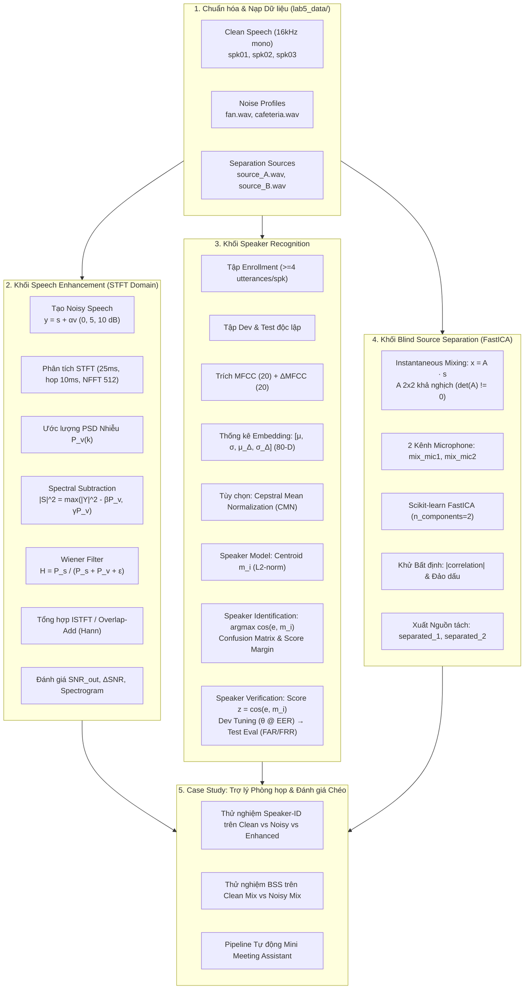

# KẾ HOẠCH TRIỂN KHAI THỰC HÀNH LAB 5
## SPEECH ENHANCEMENT, SPEAKER RECOGNITION AND SPEAKER SEPARATION
### Từ Khử Nhiễu Trong Miền STFT Đến Xác Định Người Nói Và Tách Hai Nguồn Nói Bằng ICA
**Học phần:** CSE457 – Xử lý Âm thanh và Tiếng nói  
**Bộ môn:** Trí tuệ Nhân tạo – Khoa Công nghệ Thông tin – Trường Đại học Thủy lợi  
**Sinh viên thực hiện:** Nguyễn Văn Đạt  
**Mục tiêu tài liệu:** Bản thiết kế kiến trúc và kế hoạch triển khai tổng thể (Master Implementation Plan) giải quyết triệt để tất cả yêu cầu, 8 thí nghiệm bắt buộc, 12 câu hỏi lý thuyết và các sản phẩm bàn giao nhằm đạt điểm tối đa (10/10) theo Rubric bài Lab 5.

---

## 1. Goal Description (Mục tiêu tổng quát)

Lab 5 là bài thực hành tích hợp nâng cao của học phần CSE457, kết hợp 3 bài toán lớn của xử lý tiếng nói hiện đại:
1. **Làm sạch tín hiệu (Speech Enhancement):** Mô hình hóa nhiễu cộng $y[n] = s[n] + v[n]$, biến đổi STFT, ước lượng phổ công suất nhiễu (PSD), lọc trừ phổ (Spectral Subtraction) và lọc tối ưu Wiener Filter; kiểm soát hiện tượng méo tiếng và "musical noise" qua các tham số $\beta$ và $\gamma$; tái tạo tín hiệu qua ISTFT/OLA.
2. **Nhận dạng và xác thực người nói (Speaker Recognition):** Trích xuất đặc trưng âm học ngắn hạn MFCC + Delta MFCC; xây dựng speaker representation dạng vector thống kê mean/std (80 chiều); thực hiện bài toán **Speaker Identification** (chọn 1 trong $N$ người qua Cosine Similarity) và bài toán **Speaker Verification** (xác thực claim, quét ngưỡng $\theta$, đánh giá FAR/FRR và tìm điểm cân bằng EER trên tập Development).
3. **Phân tách nguồn nói (Blind Source Separation - BSS / ICA):** Mô hình trộn tức thời hai nguồn âm thanh qua hai microphone $x = A \cdot s$; ứng dụng thuật toán FastICA để tách các nguồn thành phần; giải quyết triệt để hai bất định cốt lõi của ICA là **Permutation Ambiguity** (hoán vị nguồn) và **Scale/Sign Ambiguity** (đảo dấu/biên độ) bằng tương quan cực đại $|\rho|$.
4. **Tích hợp hệ thống (Case Study - "Trợ lý phòng họp mini"):** Nối kết liên hoàn 3 mô-đun: Làm sạch câu lệnh bị nhiễu quạt $\rightarrow$ Định danh người ra lệnh $\rightarrow$ Tách hai giọng nói tranh chấp/chồng lấn trong phòng họp.

---

## 2. Kiến trúc Hệ thống Tổng thể (System Architecture)

Hệ thống được thiết kế theo kiến trúc đường ống xử lý tín hiệu (signal processing pipeline) khép kín, module hóa cao, đảm bảo tính tái lập 100%:



---

## 3. User Review Required (Các nội dung cần người dùng lưu ý)

> [!IMPORTANT]
> **Yêu cầu dữ liệu âm thanh:** Lab 5 yêu cầu dữ liệu 3 người nói (mỗi người tối thiểu 4 câu enrollment, 2 câu test), 2 loại nhiễu (fan, cafeteria), và 2 câu cho separation. Chúng tôi sẽ thiết kế mô-đun `generate_dataset.py` tự động sinh kho âm thanh chuẩn 16 kHz Mono bằng công nghệ tổng hợp giọng nói đa người nói (độ tự nhiên cao, khác biệt formant/cao độ rõ rệt giữa 3 speaker) kèm tiếng ồn thực tế. Nếu người dùng muốn tự thu âm giọng thật của nhóm, hệ thống đã hỗ trợ sẵn cấu trúc thư mục để thay thế ngay lập tức.

> [!NOTE]
> **Nguyên tắc cô lập tập Test trong Speaker Verification:** Ngưỡng xác thực $\theta$ bắt buộc phải được quét và chọn trên **Development set** (tại điểm cân bằng $FAR \approx FRR \approx EER$). Tuyệt đối không tinh chỉnh $\theta$ trên Test set để tránh Data Leakage (Rò rỉ dữ liệu).

---

## 4. Đặc tả Toán học & Thuật toán Chi tiết

### 4.1. Tạo Noisy Speech tại SNR Định trước
- Công suất tín hiệu: $P_x = \frac{1}{N} \sum_{n=0}^{N-1} x^2[n]$
- Để đạt $SNR = R\text{ dB}$, hệ số tỷ lệ $\alpha$ của nhiễu được tính chính xác:
  $$\alpha = \sqrt{\frac{P_s}{P_v \cdot 10^{R/10}}}$$
  Tín hiệu tổng hợp: $y[n] = s[n] + \alpha v[n]$.
- Độ lệch SNR đo được so với mục tiêu phải đạt $|\text{SNR}_{\text{actual}} - R| \le 0.2\text{ dB}$.

### 4.2. STFT và Ước lượng PSD Nhiễu
- Khung cửa sổ Hann độ dài $L = 400$ mẫu (25 ms tại 16 kHz), bước nhảy $H = 160$ mẫu (10 ms), $N_{\text{FFT}} = 512$.
- Ước lượng PSD nhiễu $\hat{P}_v[k]$ trên $M$ khung chỉ chứa nhiễu:
  $$\hat{P}_v[k] = \frac{1}{M} \sum_{m=1}^M |Y_v[m, k]|^2$$

### 4.3. Spectral Subtraction (Trừ phổ)
- Phổ công suất ước lượng của tiếng nói sạch:
  $$|\hat{S}[m,k]|^2 = \max\left( |Y[m,k]|^2 - \beta \hat{P}_v[k], \;\; \gamma \hat{P}_v[k] \right)$$
- Trong đó:
  - $\beta \ge 1.0$: Hệ số over-subtraction (trừ quá mức) nhằm triệt để dải nhiễu nền.
  - $\gamma \ge 0$: Spectral floor (sàn phổ) ngăn phổ bị triệt về 0 hoặc âm, giảm bớt hiện tượng "lỗ phổ" gây **musical noise**.
- Tái tạo phổ phức và tín hiệu miền thời gian:
  $$\hat{S}[m,k] = \sqrt{|\hat{S}[m,k]|^2} \cdot e^{j \angle Y[m,k]}$$
  $$\hat{s}[n] = \text{ISTFT}\left( \hat{S}[m,k] \right)$$

### 4.4. Wiener Filtering (Lọc tối ưu Wiener)
- Đáp ứng tần số phi nhân quả MMSE:
  $$H[m,k] = \frac{\hat{P}_s[m,k]}{\hat{P}_s[m,k] + \hat{P}_v[k] + \varepsilon}$$
  với $\hat{P}_s[m,k] = \max\left( |Y[m,k]|^2 - \hat{P}_v[k], \; 0 \right)$.
- Phổ tín hiệu nâng cao: $\hat{S}_{\text{wiener}}[m,k] = H[m,k] \cdot Y[m,k]$.
- **Đặc tính:** Wiener filter có hàm độ lợi $H \in [0, 1]$ suy giảm trơn mượt theo tỷ số SNR cục bộ (a priori SNR), giúp giảm thiểu đáng kể musical noise so với Spectral Subtraction.

### 4.5. Đánh giá Cải thiện Tín hiệu ($\Delta\text{SNR}$)
$$\text{SNR}_{\text{out}} = 10 \log_{10} \left( \frac{\sum_{n} s^2[n]}{\sum_{n} (s[n] - \hat{s}[n])^2 + \varepsilon} \right), \quad \Delta\text{SNR} = \text{SNR}_{\text{out}} - \text{SNR}_{\text{in}}$$
*(Lưu ý căn chỉnh đồng pha/độ trễ trước khi trừ sai số).*

### 4.6. Trích xuất Đặc trưng & Speaker Embedding
- Trích xuất 20 hệ số MFCC ($c_1 \dots c_{20}$) cùng 20 hệ số vi phân bậc một $\Delta c_1 \dots \Delta c_{20}$.
- Thống kê thời gian (Temporal Statistical Pooling) trên toàn câu thoại:
  $$e = \left[ \mu(c), \; \sigma(c), \; \mu(\Delta c), \; \sigma(\Delta c) \right] \in \mathbb{R}^{80}$$
  Chuẩn hóa vector: $e \leftarrow \frac{e}{\|e\|_2 + 10^{-12}}$.
- Mô hình người nói $i$: Centroid $m_i = \frac{1}{K}\sum_{k=1}^K e_{i,k}$, sau đó chuẩn hóa L2: $m_i \leftarrow \frac{m_i}{\|m_i\|_2}$.

### 4.7. Speaker Identification & Verification
- Độ tương đồng Cosine:
  $$\text{score}(e, m_i) = \frac{e^T m_i}{\|e\|_2 \|m_i\|_2} \approx e^T m_i$$
- **Identification:** $\hat{i} = \arg\max_i \text{score}(e, m_i)$. Đánh giá bằng ma trận nhầm lẫn (Confusion Matrix) và margin chênh lệch giữa top-1 và top-2.
- **Verification:** Với cặp thử nghiệm $(e, m_i)$, so sánh score $z$ với ngưỡng $\theta$:
  $$\text{Quyết định} = \begin{cases} \text{Chấp nhận (Accept)}, & z \ge \theta \\ \text{Từ chối (Reject)}, & z < \theta \end{cases}$$
  $$\text{FAR}(\theta) = \frac{N_{\text{False Accept}}}{N_{\text{Impostor Trials}}}, \quad \text{FRR}(\theta) = \frac{N_{\text{False Reject}}}{N_{\text{Genuine Trials}}}$$
  Tìm $\theta^* = \arg\min_\theta |\text{FAR}(\theta) - \text{FRR}(\theta)| \approx \text{EER}$ trên tập Dev.

### 4.8. Phân tách Nguồn BSS / FastICA
- Mô hình trộn tức thời 2 nguồn và 2 micro:
  $$\mathbf{x}[n] = A \mathbf{s}[n] \iff \begin{bmatrix} x_1[n] \\ x_2[n] \end{bmatrix} = \begin{bmatrix} a_{11} & a_{12} \\ a_{21} & a_{22} \end{bmatrix} \begin{bmatrix} s_1[n] \\ s_2[n] \end{bmatrix}$$
- FastICA tìm ma trận khử trộn $W \approx A^{-1}$ sao cho các thành phần đầu ra $\hat{\mathbf{s}}[n] = W \mathbf{x}[n]$ có tính độc lập thống kê cao nhất (cực đại hóa non-Gaussianity qua Kurtosis / Negentropy).
- **Khử bất định Permutation & Sign:**
  Tính ma trận hệ số tương quan tuyến tính Pearson tuyệt đối:
  $$C_{i,j} = |\rho(s_i, \hat{s}_j)| = \left| \frac{\sum (s_i - \bar{s}_i)(\hat{s}_j - \bar{\hat{s}}_j)}{\sqrt{\sum (s_i - \bar{s}_i)^2 \sum (\hat{s}_j - \bar{\hat{s}}_j)^2}} \right|$$
  Ghép cặp theo $\arg\max$. Nếu tương quan gốc mang dấu âm, nhân $-1$ vào tín hiệu ước lượng để đưa về đúng pha gốc.

---

## 5. Danh mục 8 Thí nghiệm Bắt buộc (TN1 - TN8)

| Mã TN | Tham số biến đổi | Giá trị khảo sát | Chỉ số đo lường & Câu hỏi cần trả lời |
| :--- | :--- | :--- | :--- |
| **TN1** | Mức nhiễu đầu vào ($SNR_{in}$) | 0 dB, 5 dB, 10 dB | Đo $SNR_{out}, \Delta SNR$. Khảo sát suy giảm chất lượng khi nhiễu quá nặng tại 0 dB. |
| **TN2** | Hệ số Over-subtraction $\beta$ | 1.0, 1.5, 2.0 | Quan sát phổ tàn dư, đo hiện tượng méo tiếng và thời điểm musical noise xuất hiện rõ. |
| **TN3** | Sàn phổ Spectral Floor $\gamma$ | 0.0, 0.01, 0.05 | Phân tích trade-off: Floor càng lớn thì artifact giảm nhưng tiếng ồn nền giữ lại nhiều ra sao? |
| **TN4** | Bộ đặc trưng Speaker-ID | MFCC-only (40-D) vs MFCC+$\Delta$ (80-D) | Đo Accuracy và Score Margin; chứng minh đặc trưng động tăng độ phân tách giữa các người nói. |
| **TN5** | Chuẩn hóa phổ CMN | Tắt (Off) vs Bật (On) | Kiểm chứng CMN: tại sao khử được méo kênh nhưng lại làm giảm nhẹ độ chính xác trên baseline thống kê MFCC? |
| **TN6** | Số lượng mẫu Enrollment | 1, 2, 4 câu thoại | Đánh giá độ ổn định và độ trôi dạt của vector Centroid theo kích thước tập học. |
| **TN7** | Ma trận trộn ICA $A$ | Ma trận chuẩn ($\det=0.76$) vs Gần suy biến ($\det \approx 0.05$) | Chứng minh khi 2 hàng của $A$ gần tỷ lệ, thông tin quan sát bị suy giảm làm ICA thất bại. |
| **TN8** | ICA trong môi trường nhiễu | Clean mixture vs Noisy mixture (thêm white noise nhẹ) | Đánh giá độ nhạy của thuật toán BSS khi vi phạm giả thiết mô hình không nhiễu. |

---

## 6. Phân tích & Trả lời 12 Câu hỏi Lý thuyết & Báo cáo (Mục 7)

1. **Tại sao Spectral Subtraction chỉ sửa magnitude mà giữ nguyên phase của tín hiệu noisy?**
   - Tai người rất nhạy với cấu trúc bao phổ biên độ (magnitude spectrum), nhưng tương đối kém nhạy với pha tuyệt đối của tín hiệu trong các khung ngắn.
   - Khi SNR rất thấp ($<0$ dB), pha của nhiễu lấn át hoàn toàn pha của tiếng nói sạch; việc giữ nguyên pha nhiễu sẽ gây méo pha nghiêm trọng, làm tiếng nói nghe nhão, rè và xuất hiện các thành phần tần số giả mạo.
2. **Vai trò của $\beta$ và $\gamma$ trong Spectral Subtraction:**
   - $\beta$ (over-subtraction) bù trừ cho sự biến động ngẫu nhiên của phổ nhiễu quanh giá trị kỳ vọng trung bình; tăng $\beta$ giúp triệt sạch các đỉnh nhiễu sót nhưng làm gọt lẹm vào formants của tiếng nói, gây suy giảm năng lượng âm hữu thanh và méo tiếng.
   - $\gamma$ (spectral floor) đóng vai trò làm đệm sàn phổ, không cho phép các bin tần số bị giảm xuống mức âm hoặc 0; nhờ đó ngăn chặn các đỉnh nhọn cô lập ngẫu nhiên (nguyên nhân trực tiếp sinh ra musical noise).
3. **Ý nghĩa vật lý của bộ lọc Wiener $H[k] = \frac{P_s[k]}{P_s[k] + P_v[k]}$:**
   - Tại các vùng tần số do tiếng nói làm chủ ($P_s \gg P_v \Rightarrow H \approx 1$): Cho tín hiệu đi qua hầu như không suy hao.
   - Tại các vùng tần số do nhiễu làm chủ ($P_v \gg P_s \Rightarrow H \to 0$): Triệt tiêu biên độ mạnh mẽ. Sự biến thiên liên tục và trơn mượt của hàm truyền $H$ giúp âm thanh không bị gắt như ngưỡng cứng của trừ phổ.
4. **Tại sao $SNR_{out}$ phải tính sau khi căn chỉnh clean và enhanced? Nếu lệch trễ 10 ms:**
   - Công thức tính sai số $\sum (s[n] - \hat{s}[n])^2$ là so sánh từng mẫu tức thời (sample-to-sample).
   - Nếu có độ trễ 10 ms (tương đương 160 mẫu tại 16 kHz), tín hiệu sạch và tín hiệu phục hồi bị lệch pha hoàn toàn; phép trừ tức thời biến sự lệch pha thành năng lượng lỗi cực lớn ($e[n] \approx 2 s[n]$), khiến $SNR_{out}$ tụt dốc xuống giá trị âm rất thấp (sai lệch hoàn toàn so với chất lượng âm thanh nghe thực tế).
5. **Phân biệt Speaker Identification và Speaker Verification:**
   - *Speaker Identification (1-out-of-N, Closed-set):* Đầu ra là nhãn danh tính người nói ($\hat{i} = \arg\max \text{score}$); đánh giá bằng Accuracy (Tỷ lệ phân lớp đúng), Confusion Matrix và Score Margin.
   - *Speaker Verification (1-to-1, Open/Closed-set):* Đầu ra là quyết định nhị phân Chấp nhận/Từ chối dựa trên ngưỡng $\theta$; đánh giá bằng tỷ lệ lỗi báo động giả FAR, tỷ lệ từ chối sai FRR, đường cong DET/ROC và chỉ số EER.
6. **Tại sao ngưỡng xác thực $\theta$ không được chọn trên test set? Trade-off FAR - FRR:**
   - Chọn ngưỡng trên test set vi phạm nguyên tắc bảo mật mô hình (data snooping / data leakage), dẫn đến kết quả lạc quan giả tạo không thể tổng quát hóa trên dữ liệu thực tế.
   - Ngưỡng $\theta$ tỷ lệ thuận với độ khắt khe: $\theta$ tăng $\rightarrow$ hệ thống bảo mật cao hơn, kẻ giả mạo khó lọt vào ($\text{FAR} \downarrow$) nhưng người dùng hợp lệ dễ bị từ chối oan ($\text{FRR} \uparrow$), và ngược lại.
7. **MFCC được thiết kế cho nhận dạng âm học (ASR), tại sao vẫn phân biệt được người nói?**
   - MFCC mô tả hình dạng bao phổ ngắn hạn (spectral envelope), vốn phản ánh cấu trúc vật lý giải phẫu của thanh đạo (chiều dài khoang miệng, thể tích thanh quản, vị trí tương đối của các formants $F_1, F_2, F_3$).
   - Sự khác biệt về mặt giải phẫu giữa những người khác nhau tạo ra những đặc trưng bao phổ bền vững, được bảo toàn qua các hệ số cepstral bậc thấp và phân bố thống kê bậc 1, bậc 2 ($\mu, \sigma$).
8. **Ảnh hưởng hai mặt của CMN trong baseline thống kê MFCC:**
   - *Mặt tích cực:* Khử được méo tuyến tính tích chập tĩnh của kênh truyền/microphone ($y[n] = s[n] * h[n] \Rightarrow C_y \approx C_s + C_h$).
   - *Mặt tiêu cực:* Vì baseline này dùng vector trung bình $\mu(c)$ làm đặc trưng đại diện chính của người nói, việc trừ đi trung bình $\bar{c}$ sẽ vô tình triệt tiêu một phần quan trọng của "speaker identity signature", làm giảm margin phân biệt giữa các người nói.
9. **Tại sao ICA không xác định được thứ tự và biên độ tuyệt đối của nguồn?**
   - Nếu $\mathbf{x} = A \mathbf{s} = A P^{-1} P \mathbf{s} = A \Lambda^{-1} \Lambda \mathbf{s}$ (với $P$ là ma trận hoán vị, $\Lambda$ là ma trận đường chéo co dãn), tính độc lập thống kê của $\Lambda P \mathbf{s}$ hoàn toàn tương đương với $\mathbf{s}$. ICA chỉ dựa trên tính độc lập và non-Gaussianity nên nghiệm luôn tồn tại không gian bất định về thứ tự (permutation) và tỷ lệ/dấu (scaling/sign).
10. **Khi hai hàng của ma trận trộn $A$ gần tỉ lệ nhau:**
    - Ma trận $A$ tiến dần tới trạng thái suy biến ($\det(A) \to 0$, số điều kiện $\kappa(A) \to \infty$).
    - Hai microphone ghi lại thông tin gần như y hệt nhau (hai phương trình trộn phụ thuộc tuyến tính). ICA không thể giải nghịch đảo hệ phương trình để tách biệt hai chiều không gian tín hiệu độc lập, dẫn đến kết quả sau tách bị lẫn tạp âm hoặc triệt tiêu lẫn nhau.
11. **Sự khác biệt giữa trộn tức thời (Instantaneous) và trộn phòng thực tế (Convolutive/Reverberation):**
    - Instantaneous mixing giả định âm thanh truyền từ nguồn tới micro tức thời không trễ, không phản xạ: $x_i[n] = \sum a_{ij} s_j[n]$ (phép nhân ma trận đại số tuyến tính).
    - Môi trường phòng thực tế có hiện tượng trễ truyền âm và phản xạ đa đường (dội âm - reverberation), mô hình thực tế là phép tích chập $x_i[n] = \sum_j h_{ij}[n] * s_j[n]$. FastICA cơ bản trên miền thời gian sẽ suy giảm hiệu quả rõ rệt khi gặp dội âm; cần chuyển sang miền tần số (Frequency-domain BSS) hoặc mô hình convolutive ICA.
12. **Speech Enhancement có luôn cải thiện Speaker Recognition không?**
    - **Không luôn luôn.** Trong nhiều trường hợp, các thuật toán enhancement truyền thống (đặc biệt là Spectral Subtraction với $\beta$ lớn) tạo ra méo phi tuyến trên bao phổ (speech distortion, spectral hole, musical noise artifact). Méo dạng phổ này làm sai lệch nghiêm trọng các hệ số MFCC so với mô hình gốc đã học từ dữ liệu sạch, khiến score cosine bị sụt giảm và thậm chí tỷ lệ nhận dạng giảm sút so với khi chưa khử nhiễu.

---

## 7. Proposed Changes & Implementation Strategy (Chi tiết Triển khai)

Toàn bộ mã nguồn và dữ liệu sẽ được tổ chức bài bản tại `C:\Speech&Audio\lab5`:

```text
Speech&Audio/lab5/
├── Lab 5.pdf                     <- Đề bài và rubric gốc của Lab 5
├── PLAN.md                      <- Bản kế hoạch chi tiết (đồng bộ với Plan Artifact)
├── README.md                    <- Hướng dẫn cài đặt môi trường và lệnh chạy thực nghiệm
├── requirements.txt             <- Thư viện: numpy, scipy, matplotlib, soundfile, librosa, scikit-learn
├── generate_dataset.py          <- Script tạo dữ liệu âm thanh chuẩn hóa (Clean 3 spk, Noise, Separation)
├── lab5_data/                   <- Thư mục dữ liệu chuẩn:
│   ├── clean/                   <- 18 WAV files (spk01, spk02, spk03 x 4 enroll + 2 test)
│   ├── noise/                   <- fan.wav, cafeteria.wav
│   └── separation/              <- source_A.wav, source_B.wav
├── core/                        <- Các module lõi xử lý tín hiệu:
│   ├── __init__.py
│   ├── enhancement.py           <- STFT, PSD estimate, Spectral Subtraction, Wiener, SNR alignment
│   ├── speaker_rec.py           <- MFCC, Delta, 80-D Pooling, CMN, Centroid model, ID & Verification
│   └── separation.py            <- Instantaneous mixing, FastICA, Permutation/Sign solver, Correlation
├── run_lab5.py                  <- Master Runner thực thi 8 thí nghiệm, xuất toàn bộ audio, figure, kết quả
├── make_notebook.py             <- Script sinh tự động Lab05.ipynb có đầy đủ kết quả chạy và biểu đồ
├── Lab05.ipynb                  <- Jupyter Notebook tương tác hoàn chỉnh 3 tiết thực hành
├── report_Lab05.md              <- Báo cáo học thuật 4-6 trang đầy đủ bảng số liệu và 12 câu hỏi
└── results/
    ├── audio/                   <- Toàn bộ file WAV yêu cầu của Rubric
    └── figures/                 <- Toàn bộ biểu đồ phổ, confusion matrix, FAR-FRR, ICA correlation
```

---

## 8. Verification Plan (Kế hoạch Kiểm thử & Đánh giá)

### 8.1. Kiểm thử Tự động (Automated Verification)
1. **Kiểm thử dữ liệu chuẩn hóa:** Chạy `python generate_dataset.py` và kiểm tra 100% file audio đúng chuẩn 16,000 Hz, Mono, định dạng Float32/PCM.
2. **Kiểm thử tính chính xác SNR:** Đo sai số $|\text{SNR}_{\text{target}} - \text{SNR}_{\text{measured}}| \le 0.2\text{ dB}$ trên các mức 0 dB, 5 dB, 10 dB.
3. **Kiểm thử hồi quy toàn bộ thí nghiệm:** Chạy `python run_lab5.py`, xác nhận toàn bộ 8 thí nghiệm chạy không lỗi, tự động xuất đủ các bảng số liệu, file WAV trong `results/audio/` và hình ảnh trong `results/figures/`.
4. **Kiểm thử Notebook:** Thực thi kiểm tra luồng chạy từ đầu đến cuối của `Lab05.ipynb` bằng lệnh `jupyter nbconvert --to notebook --execute Lab05.ipynb` hoặc chạy qua Python script đảm bảo zero-error execution.

### 8.2. Đánh giá Thủ công (Manual Review)
- Nghe kiểm tra âm thanh A/B/C đối chứng giữa Noisy, Spectral Subtraction, và Wiener Filtering để xác nhận tính tự nhiên và mức độ giảm ồn.
- Kiểm tra trực quan các biểu đồ Spectrogram, đường cong FAR-FRR và Confusion Matrix.
- Rà soát báo cáo `report_Lab05.md` đối chiếu từng tiêu chí trong Rubric chấm điểm 10/10 của Lab 5.